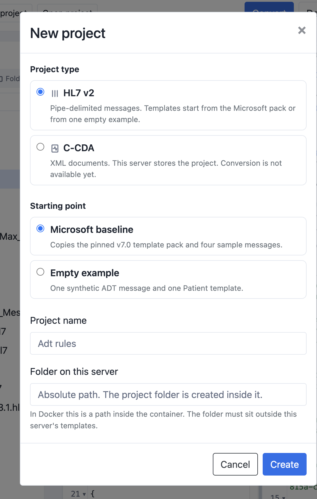
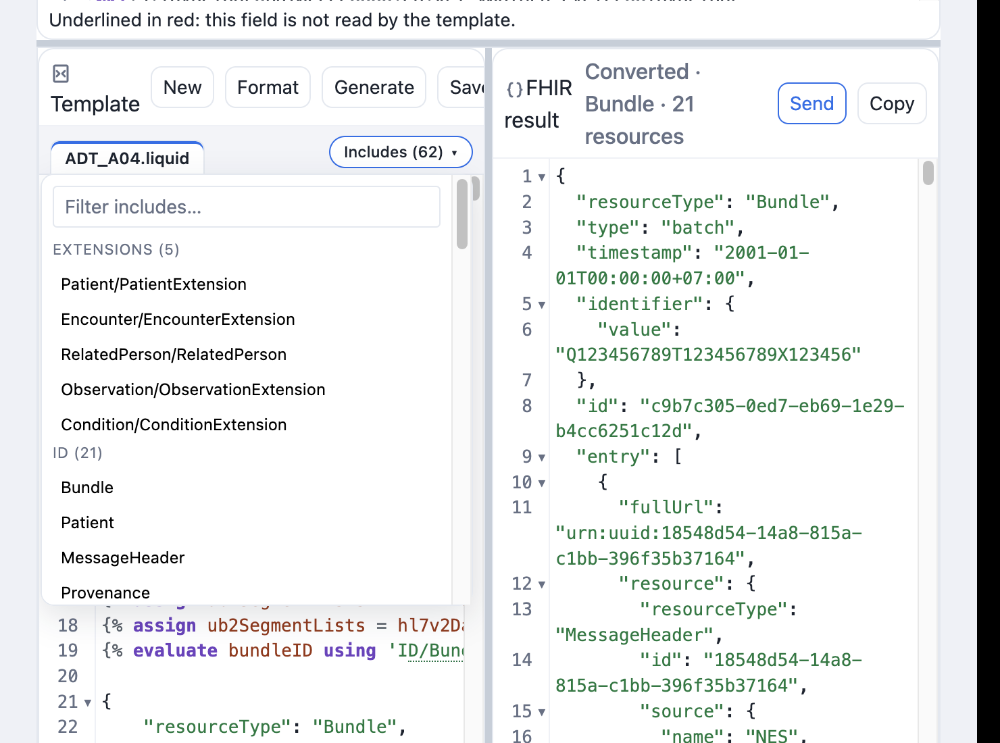
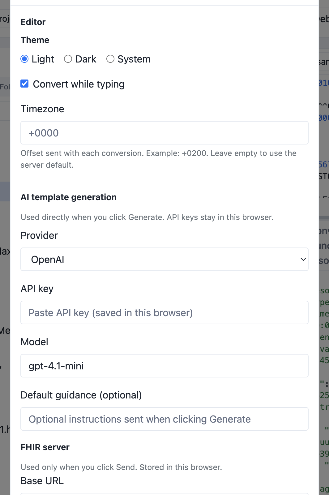
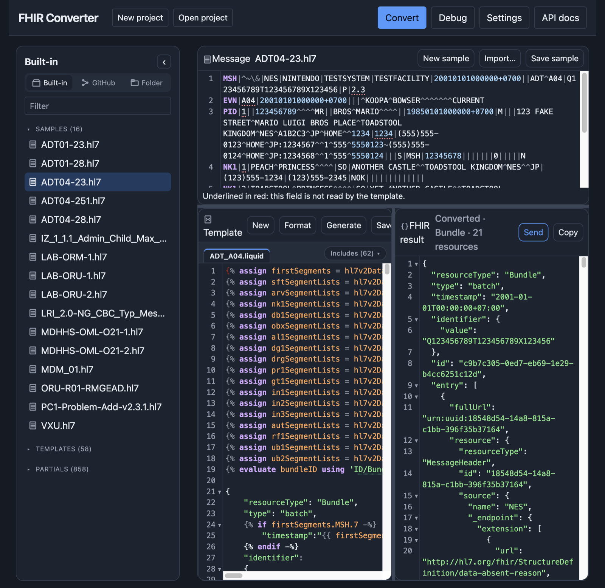
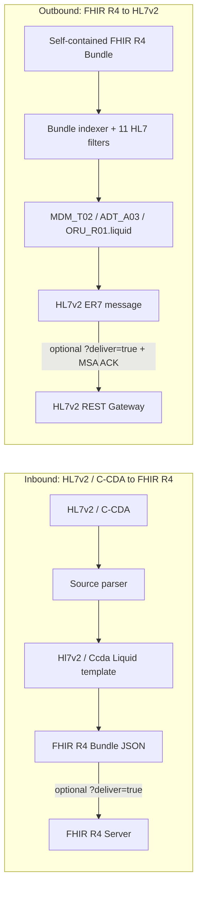

# fhir-converter-liquid

[](https://github.com/gjergjsheldija/fhir-converter-liquid/actions/workflows/ci.yml)
[](LICENSE)
[](package.json)

**Bidirectional HL7v2 &harr; FHIR R4 (plus C-CDA &rarr; FHIR R4), powered by [Liquid](https://shopify.github.io/liquid/) templates.**

A standalone conversion service, studio, and multi-customer integration hub compatible with [Microsoft's FHIR Converter](https://github.com/microsoft/FHIR-Converter) template library — convert inbound HL7v2 and C-CDA messages into FHIR R4 Bundles, render outbound HL7v2 ER7 messages (`MDM^T02`, `ADT^A03`, `ORU^R01`) from self-contained FHIR R4 Hospital Discharge Bundles, and deliver directly to FHIR R4 servers and HL7v2 REST gateways through Vault-backed customer pipelines.


## Contents

- [Features](#features)
- [Quick start](#quick-start)
- [Web UI](#web-ui)
- [API](#api)
- [Working with Liquid templates](#working-with-liquid-templates)
- [Customer pipelines & Vault](#customer-pipelines--vault)
- [Configuration](#configuration)
- [Docker](#docker)
- [Project layout](#project-layout)
- [Contributing](#contributing)

## Features

**Conversion**

- **Inbound (`HL7v2` & `C-CDA` &rarr; `FHIR R4`):** HL7v2 templates for every major trigger-event family (`ADT`, `BAR`, `DFT`, `MDM`, `OMG`, `OML`, `ORM`, `ORU`, `OUL`, `RDE`, `RDS`, `REF`, `SIU`, `VXU`) and C-CDA project packs
- **Outbound (`FHIR R4` &rarr; `HL7v2`):** Reverse conversion from self-contained FHIR R4 `document` and `collection` Bundles — including Hospital Discharge Summary (`Composition` LOINC `18842-5` + `Patient`, `Encounter`, `Condition`, `Procedure`, `AllergyIntolerance`, `MedicationRequest`, and Base64 PDF `DocumentReference`) and Structured Discharge Assessment (`QuestionnaireResponse`) — into built-in `MDM^T02`, `ADT^A03`, and `ORU^R01` ER7 messages with pre-indexed Bundle context and 11 healthcare output filters ([guide](docs/features/fhir-to-hl7v2.md))
- Bare `\r` MLLP segment terminators and `MSH-18` character set decoding (`8859/1`, `ISO-8859-15`, `WINDOWS-1252`, `UTF-8`)
- Multi-facility HIE site packs: `conceptmaps/*.json` (with optional `"preserveSource": true` to retain local hospital codes alongside LOINC/SNOMED) and `identifiers.json` Assigning Authority rules (`MR@HOSP_A`, `byAssigner`, `bySystem`, `override`)
- Clean `FHIR Converter Liquid` Provenance narratives in generated Bundles (no `TEMPLATE_VERSION_PLACEHOLDER` strings or upstream tarball URLs)
- Per-request template overrides — test a template change against real data without touching what's stored on the server
- Diagnostics on demand: `unusedSegments` (data the template ignored), `invalidAccess` (fields the template reached for but weren't there), non-standard unmapped codes, and case-mismatched Liquid variables
- Timezone-aware date/time conversion via request header

**Editor**

- Browser workspace with an **HL7v2 → FHIR** / **FHIR → HL7v2** direction toggle, syntax coloring, folding, and a Liquid formatter
- Files pane for samples, templates, and partials (starter pack, a local folder, customer pipeline, or GitHub). Menu (Cmd-K) holds customer, settings, and docs commands
- Live conversion, plus a debug drawer: parsed HL7, parsed CDA, or indexed FHIR Bundle context (`byType`, `byRef`, `patient`, `encounter`), variable console, unused fields, case-mismatched variable warnings, and hover values on Liquid paths and HL7 fields
- Includes list grouped by folder; open a partial, or start a new one by name
- Projects: HL7 v2 or C-CDA, from the Microsoft baseline or an empty example. Open a local folder or a GitHub repo, convert and save against that project
- C-CDA editor: XML coloring, parsed CDA tree, hover paths, and expected-bundle diff
- Validate FHIR results against `{base}/$validate` (with an optional profile URL), **Send** FHIR Bundles to a FHIR server (`urn:uuid:` conditional create `If-None-Exist` or conditional update `PUT`), or **Send** rendered ER7 messages in `FHIR → HL7v2` mode to an **HL7v2 REST gateway** with `MSA` ACK verification
- Generate maps can score the field map against an IG ConceptMap loaded in the browser. Clicking a value in the FHIR result names the Liquid include and direct HL7 source field that wrote it
- AI template generation from Settings. Paste an API key for OpenAI, Anthropic, Google Gemini, xAI (Grok), Mistral, DeepSeek, Groq, OpenRouter, or point at a local OpenAI-compatible server
- Light, dark, and system themes

**Serving, pipelines & tooling**

- Per-customer bidirectional pipelines (`CUSTOMERS_ROOT`, default `./customers/<customerId>/`) with `config.yaml`, `input/` (`HL7v2 -> FHIR`), `output/` (`FHIR -> HL7v2`), `?deliver=true` direct delivery to FHIR R4 servers and HL7v2 REST gateways, and pluggable secret resolution across `aws-sm://`, `vault://` (OpenBao / HashiCorp Vault KV v2), `infisical://`, `file://`, and `env://` with `#jsonKey` extraction, TTL caching, and automatic `401` token refresh ([guide](docs/features/customer-pipelines.md))
- REST API with interactive OpenAPI/Swagger docs (`/api-docs`), plus headless project conversion at `POST /api/v1/projects/:projectId/convert/:template` (resolved under `PROJECTS_ROOT`, default `./projects`)
- `HEADLESS_RUNTIME=true` mode for cloud/production deployments (disables browser studio, folder browse, template writes, and studio proxy routes with `403`; keeps `/health`, `/version`, `/metrics`, and authenticated convert and customer pipeline routes active)
- `CONVERT_API_KEY` Bearer protection across convert, customer pipeline, and sensitive studio/management routes, with non-blocking async `5 MB`-rotated PHI-free `MSH-10` audit and failure logs
- Project CLI (`bin/convert.mjs` / `npm run convert:project`) for HL7 v2 and C-CDA single conversions or `--check-goldens` checks
- Open Integration Engine channel (`integrations/oie/hl7v2-to-fhir.xml`) with dynamic `MSH-9` routing, optional `CONVERT_API_KEY` header forwarding, and `MSA|AA` / `MSA|AE` ACK/NACK responses
- Prometheus metrics, structured logging, `/health` and `/version` endpoints
- Multi-stage Docker build (prod / dev / test) with a docker-compose + Makefile workflow

## Quick start

**Install**

```bash
npm ci
cp .env.example .env   # tweak PORT, CONVERSION_TIMEOUT_MS, LOG_LEVEL if needed
```

**Run**

```bash
npm start               # serves on http://localhost:2019
```

**Test**

```bash
npm test                # unit tests (mocha + nyc coverage)
npm run eslint          # lint
```

**Convert a message**

```bash
# Inbound: convert an HL7v2 ADT^A01 message -> FHIR R4 Bundle
curl -X POST http://localhost:2019/api/v1/convert/hl7v2/ADT_A01 \
  -H "Content-Type: text/plain" \
  --data-binary @src/sample-data/hl7v2/ADT01-23.hl7

# Outbound: convert a self-contained FHIR R4 Discharge Bundle -> raw ER7 HL7v2 MDM^T02
curl -X POST http://localhost:2019/api/v1/convert/fhir/MDM_T02 \
  -H "Content-Type: application/fhir+json" \
  -H "Accept: application/hl7-v2" \
  --data-binary @discharge-bundle.json
```

## Web UI

Open `http://localhost:2019`. The screenshot above is that workspace: files on the left, the source message/Bundle and Liquid template in the middle, the converted FHIR R4 Bundle or HL7v2 ER7 output on the right, and the debug drawer along the bottom.

1. Toggle **HL7v2 → FHIR** or **FHIR → HL7v2** in the studio header. Pick a sample, paste a message or FHIR Bundle, or use **New sample** / **Import…** / **Save sample**. Samples you add in Built-in mode go to gitignored `src/service-samples/`, not the vendored `src/sample-data/` tree.
2. Open a template (`ADT_A01`, `ORU_R01`, etc. in inbound mode; `MDM_T02`, `ADT_A03`, `ORU_R01` in outbound mode). With live update on, the output updates as you edit either side. **Run** executes conversion immediately.
3. **Format** pretty-prints the Liquid or JSON in the active editor. **Save** writes the template to the built-in runtime tree, or into the open local project.
4. **Includes** lists the partials for the open template, grouped by folder. Click one to open it. A name that is not on disk yet opens a new tab; nothing is written until you save.
5. **Send** pushes a FHIR Bundle to the configured **FHIR server** (`HL7v2 → FHIR`) or pushes a rendered ER7 message to the configured **HL7v2 gateway** and verifies `MSA|AA` (`FHIR → HL7v2`).
6. **Debug** opens the bottom drawer: parsed HL7/CDA or indexed FHIR Bundle (`byType`, `byRef`, `patient`, `encounter`), variable console, and diagnostics. Hover a Liquid path such as `firstSegments.MSH.10`, or a field in the message, to see the value conversion read.
7. **API docs** opens the Swagger UI also served at `/api-docs`.

The files pane folds Samples, Templates, and Partials, and collapses to a rail.

### Projects



**New project** creates a folder and a `fhir-converter.json` manifest.

| Choice | What you get |
| --- | --- |
| HL7 v2, Microsoft baseline | The pinned v7.0 template pack and four sample messages |
| HL7 v2, empty example | One synthetic ADT message and one Patient template |
| C-CDA, Microsoft baseline | The pinned v7.0 C-CDA template pack and one sample document |
| C-CDA, empty example | One synthetic C-CDA document and one example template |

**Open project** loads a local folder, or a GitHub repository at a ref. Conversion and includes then resolve from that project. A GitHub project is read-only here: Save explains that and does not write. A local HL7 project can later copy in the official 139 HL7 v2 sample messages.

Each feature is described on its own page from [docs/features.md](docs/features.md).

### Includes



### Settings and AI generate



**Settings** stores the theme, convert-while-typing, the timezone sent on each conversion, and AI template generation. Light, dark, and system apply as soon as you pick one. The API key stays in this browser.



**Generate** uses the provider and key from Settings and does not ask for them again. Supported providers:

| Provider | What you configure |
| --- | --- |
| OpenAI, Anthropic (Claude), Google Gemini, xAI (Grok), Mistral, DeepSeek, Groq, OpenRouter | API key. The server fills the base URL and a default model |
| Local (oMLX / Ollama) | Base URL. No API key |
| Custom (OpenAI-compatible) | Base URL and API key |

If the chosen provider needs a key and none is stored, Generate opens Settings on the key field.

### Where Save writes

| Action | Destination |
| --- | --- |
| Save, built-in `HL7v2 → FHIR` templates | `src/service-templates/Hl7v2/` |
| Save, built-in `FHIR → HL7v2` templates | `src/service-templates/FhirToHl7v2/` |
| Save, local project | That project's template folder |
| Save, GitHub project | Refused. The checkout stays read-only |
| Save sample, built-in | `src/service-samples/` (gitignored) |
| Save sample, local project | That project's samples folder |

Do not hand-edit vendored files under `src/templates/`, `src/sample-data/`, or the official expected-result fixtures. Restore them with the commands in [Working with Liquid templates](#working-with-liquid-templates).

## API

All endpoints are versioned under `/api/v1`. Full interactive reference: `GET /api-docs` (Swagger UI) / `GET /api-docs.json` (raw OpenAPI spec).

| Method | Path                                                  | Description                                                                                                                  |
| ------ | ----------------------------------------------------- | ---------------------------------------------------------------------------------------------------------------------------- |
| GET    | `/api/v1/parsers`                                     | List available source-data parsers                                                                                           |
| GET    | `/api/v1/templates`                                   | List templates on the server                                                                                                 |
| GET    | `/api/v1/templates/{file}`                            | Fetch a specific template's contents                                                                                         |
| GET    | `/api/v1/sample-data`                                 | List bundled sample messages                                                                                                 |
| GET    | `/api/v1/sample-data/{file}`                          | Fetch a specific sample message                                                                                              |
| POST   | `/api/v1/convert/{srcDataType}`                       | Convert data using an inline template (`templateBase64`, plus optional `templatesOverrideBase64`) passed in the request body |
| POST   | `/api/v1/convert/{srcDataType}/{template}`            | Convert data using a template already stored on the server                                                                   |
| POST   | `/api/v1/convert/fhir`                                | Convert a self-contained FHIR R4 `Bundle` to HL7v2 ER7 using an inline Liquid template                                       |
| POST   | `/api/v1/convert/fhir/:template`                      | Convert a FHIR R4 `Bundle` to HL7v2 (`MDM_T02`, `ADT_A03`, `ORU_R01`); negotiates `Accept: application/json` vs `Accept: application/hl7-v2` |
| POST   | `/api/v1/convert/ccda`                                | Convert a C-CDA document with an inline template                                                                             |
| PUT    | `/api/v1/templates/{file}`                            | Save a template into the runtime template tree                                                                               |
| PUT    | `/api/v1/sample-data/hl7v2/{file}`                    | Save a user sample message                                                                                                   |
| GET    | `/api/v1/ai/providers`                                | List AI providers (label, format, whether a key is required)                                                                 |
| POST   | `/api/v1/templategenerate`                            | Generate a Liquid template from a message. A known provider takes `provider` and `apiKey`; the server supplies the URL and default model |
| POST   | `/api/v1/projects`                                    | Create a local project                                                                                                       |
| POST   | `/api/v1/projects/open`                               | Open a local project folder                                                                                                  |
| POST   | `/api/v1/projects/open-github`                        | Open a GitHub project read-only                                                                                              |
| POST   | `/api/v1/projects/convert`                            | Convert using the open project's templates                                                                                   |
| POST   | `/api/v1/projects/{projectId}/convert/{template}`     | Headless conversion against `:projectId` under `PROJECTS_ROOT` (applies project templates, `declaredSegments`, and `sitePack`) |
| PUT    | `/api/v1/projects/file`                               | Save a file into a local project                                                                                             |
| POST   | `/api/v1/projects/official-samples`                   | Copy the official 139 HL7 v2 samples into a local project                                                                    |
| POST   | `/api/v1/fhir/validate`                               | POST the FHIR result to `{base}/$validate`. A non-empty `profile` is sent as the `profile` query parameter                   |
| POST   | `/api/v1/fhir/send`                                   | POST the FHIR result. `conditional: true` or `update: true` builds a `urn:uuid:` transaction Bundle. Both together is 400    |
| POST   | `/api/v1/hl7v2/send`                                  | POST a rendered ER7 HL7v2 message (`json_envelope` or `raw_er7`) to an HL7v2 REST gateway and verify the `MSA` ACK           |
| GET    | `/api/v1/customers`                                   | List configured customer pipelines under `CUSTOMERS_ROOT`                                                                    |
| GET    | `/api/v1/customers/:customerId`                       | Fetch a customer's pipeline metadata, `input/` and `output/` template lists, and target config (secrets redacted)            |
| POST   | `/api/v1/customers/:customerId/inbound/:template`     | Convert `HL7v2 -> FHIR` using customer `input/` templates; `?deliver=true` pushes directly to the customer's `fhirServer`    |
| POST   | `/api/v1/customers/:customerId/outbound/:template`    | Convert `FHIR -> HL7v2` using customer `output/` templates; `?deliver=true` pushes to `hl7v2Gateway` and verifies `MSA\|AA`  |
| GET    | `/api/v1/conversions/failures`                        | Recent failed conversions, plus success and failure counts since process start                                               |
| GET    | `/health`                                             | Liveness check                                                                                                               |
| GET    | `/version`                                            | Build version                                                                                                                |

Useful query/header options on the convert endpoints:

| Name                  | Where  | Effect                                                                                   |
| --------------------- | ------ | ---------------------------------------------------------------------------------------- |
| `unusedSegments=true` | query  | Include segments present in the source but never accessed by the template               |
| `invalidAccess=true`  | query  | Include fields the template tried to read that didn't exist                              |
| `debug=true`          | query  | Include `debugInfo` (timing, parsed HL7, and template scopes) for the editor drawer      |
| `timezone`            | header | Normalize date/times to a given IANA/offset timezone, e.g. `America/New_York` or `+0400` |

```bash
curl -X POST "http://localhost:2019/api/v1/convert/hl7v2/ADT_A01?unusedSegments=true&invalidAccess=true" \
  -H "Content-Type: text/plain" \
  -H "timezone: Europe/Berlin" \
  --data-binary @message.hl7
```

## Working with Liquid templates

Conversion in both directions is template-driven:

- **Inbound (`HL7v2 -> FHIR R4`):** An entry-point template (e.g. `ADT_A01.liquid`) parses HL7 segments and pulls in reusable `CodeSystem`, `DataType`, `Extensions`, and `ID` partials to emit a FHIR R4 Bundle.
- **Outbound (`FHIR R4 -> HL7v2`):** An entry-point template (`MDM_T02.liquid`, `ADT_A03.liquid`, `ORU_R01.liquid`) reads a pre-indexed self-contained FHIR R4 `Bundle` (`bundle`, `byType`, `byRef`, `patient`, `encounter`, `composition`, `questionnaireResponse`, `customer`) and 11 healthcare output filters (`hl7_escape`, `strip_xhtml`, `hl7_datetime`, `hl7_control_id`, `resolve_ref`, `identifier_by_system`, `identifier_by_type`, `coding_by_system`, `map_gender`, `map_doc_status`, `flatten_qr_items`) to render `\r`-delimited ER7 segments. See [FHIR to HL7 v2](docs/features/fhir-to-hl7v2.md).



**Where they live:**

| Path                                 | Contents                                                                                                                                  |
| ------------------------------------ | ----------------------------------------------------------------------------------------------------------------------------------------- |
| `src/templates/Hl7v2/`               | Microsoft's base HL7v2 Liquid templates (entry points + `CodeSystem`, `DataType`, `Extensions`, `ID` includes)                            |
| `src/templates/FhirToHl7v2/`         | Built-in reverse `FHIR -> HL7v2` Liquid templates (`MDM_T02.liquid`, `ADT_A03.liquid`, `ORU_R01.liquid`, plus shared segment partials)    |
| `src/service-templates/`             | Runtime copy of `Hl7v2/` and `FhirToHl7v2/` — regenerated from `templates/` on startup by `src/init-service.js`; edit here to customize   |
| `src/sample-data/`                   | Sample HL7v2 messages and FHIR R4 Hospital Discharge Bundles (`Composition` LOINC `18842-5` and `QuestionnaireResponse`)                  |
| `customers/<customerId>/{input,output}` | Per-customer `HL7v2 -> FHIR` (`input/`) and `FHIR -> HL7v2` (`output/`) template overrides paired with `config.yaml`                   |

**This project is template-compatible with [microsoft/FHIR-Converter](https://github.com/microsoft/FHIR-Converter)** — because it uses the same Liquid syntax and the same `hl7v2FHIR`-style helper filters, you can:

- Drop newer or additional templates straight from Microsoft's repo into `src/service-templates/Hl7v2/` — no code changes needed
- Author your own templates the same way: start from an existing `.liquid` file, use `` to reuse the shared building blocks, and reference [Liquid's own syntax docs](https://shopify.github.io/liquid/) plus the [HL7 v2-to-FHIR mapping project](https://confluence.hl7.org/display/OO/2-To-FHIR+Project) for field-level guidance
- Iterate fast with the web UI (instant preview) or with `templatesOverrideBase64` on `POST /api/v1/convert/{srcDataType}` (test one or more templates against real data with nothing written to disk)
- Use `unusedSegments`/`invalidAccess` on a convert call to spot exactly what your template is missing or mis-referencing in the source message

To restore the bundled HL7v2 templates and official expected-result fixtures from the exact Microsoft revision pinned in `test/e2e-test/liquid-fixtures/UPSTREAM_VERSION.md`, run:

```bash
make sync-templates
make sync-expected-results
make sync-hl7v2-samples
```

The first command replaces both the source template directory and the generated runtime copy. The second replaces the test suite's expected JSON files with Microsoft's checked-in results. The third replaces the UI's bundled HL7v2 sample messages with Microsoft's full sample set. All three verify the pinned commit and copied contents. Do not edit vendored Liquid files, expected results, or bundled sample messages by hand.

## Customer pipelines & Vault

Multi-hospital deployments isolate each tenant under `CUSTOMERS_ROOT` (default `./customers`):

```text
customers/
└── <customerId>/
    ├── config.yaml      # Identifiers, MSH defaults, requireCorrelationIds, targets, secretRef URIs
    ├── input/           # Customer HL7v2 -> FHIR templates & partials (falls back to built-in Hl7v2)
    └── output/          # Customer FHIR -> HL7v2 templates & partials (falls back to built-in FhirToHl7v2)
```

Target credentials in `config.yaml` (`targets.fhirServer.auth` with `oauth2_client_credentials` / `bearer` / `basic`, and `targets.hl7v2Gateway.auth`) use URI secret references (`aws-sm://`, `vault://`, `infisical://`, `file://`, `env://`) with `#jsonKey` extraction, in-memory TTL caching, and automatic `401` secret/token refresh. Full walkthrough and annotated `config.yaml`: [Customer pipelines & Vault](docs/features/customer-pipelines.md).

## Configuration

`.env` (see `.env.example`):

| Variable                | Default       | Purpose                                                                                                             |
| ----------------------- | ------------- | ------------------------------------------------------------------------------------------------------------------- |
| `PORT`                  | `2019`        | HTTP port                                                                                                           |
| `CONVERSION_TIMEOUT_MS` | `30000`       | Per-message conversion timeout                                                                                      |
| `LOG_LEVEL`             | `info`        | Winston log level                                                                                                   |
| `CONVERT_API_KEY`       | unset         | Require `Authorization: Bearer <key>` on convert, customer pipeline, and sensitive studio/management routes         |
| `HEADLESS_RUNTIME`      | `false`       | Disable browser studio, browse, write, and studio proxy routes (`403`); keep health, metrics, convert, and customer pipelines active |
| `PROJECTS_ROOT`         | `./projects`  | Base folder used to resolve `:projectId` on `POST /api/v1/projects/:projectId/convert/:template`                    |
| `CUSTOMERS_ROOT`        | `./customers` | Base folder used to discover per-customer pipelines (`config.yaml`, `input/`, `output/`) for `/api/v1/customers*`   |
| `SECRETS_FILE_ROOT`     | `/run/secrets` | Root directory confining `file://` secret references (e.g. Kubernetes mounted `Secret` / CSI Driver volumes)       |
| `AWS_REGION`            | unset         | AWS region used when resolving `aws-sm://` secrets via `@aws-sdk/client-secrets-manager`                            |
| `VAULT_ADDR`            | unset         | OpenBao / HashiCorp Vault server URL for `vault://` KV v2 secret resolution                                         |
| `VAULT_TOKEN`           | unset         | Token used to authenticate `vault://` KV v2 requests against `VAULT_ADDR`                                           |
| `INFISICAL_URL`         | `https://app.infisical.com` | Base URL for `infisical://` secret resolution (override for self-hosted Infisical)                    |
| `INFISICAL_TOKEN`       | unset         | Bearer access token for `infisical://` secret lookups                                                               |

## Internal Production Runtime (`src/runtime.js`)

For internal hospital-gateway-to-FHIR-server deployments, run the lean runtime entrypoint instead of the full Studio server:

```bash
npm run start:runtime   # node src/runtime.js
```

`src/runtime.js` mounts **only** transformation (`/api/v1/convert/*`), customer pipelines (`/api/v1/customers*`), direct FHIR/HL7v2 delivery (`/api/v1/fhir/*`, `/api/v1/hl7v2/send`), Kubernetes probes (`/health`, `/healthz`, `/readyz`), `/version`, and `/metrics`. Studio static assets, `/api/v1/browse`, `/api/v1/projects`, `/api/v1/templategenerate`, `/api/v1/templates`, and Swagger UI (`/api-docs`, unless `ENABLE_SWAGGER=true`) are not mounted at all.

- **Probes:** `GET /healthz` (liveness `200 { status: "OK" }`) and `GET /readyz` (readiness `200 { status: "READY", workers }` or `503 { status: "NOT_READY" }` when workers or templates are unavailable).
- **Request tracing & JSON errors:** `X-Request-Id` (generated if absent) and W3C `traceparent` are propagated to downstream FHIR/HL7v2 calls; all error responses (including malformed JSON `400`, payload limit `413`, queue saturation `503`, and timeouts `504`) return structured JSON with `requestId` and optional `phase`.
- **Lifecycle:** `SIGTERM`/`SIGINT` drains HTTP connections before destroying the worker pool; `SIGHUP` clears the customer config cache and broadcasts a template reload to workers.

Key runtime tuning environment variables:

| Variable                  | Default   | Purpose                                                                                             |
| ------------------------- | --------- | --------------------------------------------------------------------------------------------------- |
| `WORKER_CONCURRENCY`      | cgroup/CPU | Worker thread pool size for Liquid conversions                                                     |
| `WORKER_MAX_QUEUE`        | `256`     | Maximum queued conversion tasks before rejecting with `503`                                         |
| `WORKER_TASK_TIMEOUT_MS`  | `30000`   | Per-task worker timeout before rejecting with `504`                                                 |
| `MAX_BODY_SIZE`           | `10mb`    | Express JSON/text body size limit (`413` when exceeded)                                             |
| `STATELESS_RUNTIME`       | `false`   | Set `true` in production containers (`readOnlyRootFilesystem: true`) to skip local disk state       |
| `CUSTOMER_CACHE_TTL_MS`   | `30000`   | In-memory TTL for loaded customer `config.yaml` entries (invalidated immediately on `SIGHUP`)       |
| `ENABLE_OUTBOUND_DELIVERY`| `true`    | Toggle outbound HTTP delivery to downstream FHIR servers and HL7v2 gateways                         |
| `ENABLE_SWAGGER`          | `false`   | Enable `/api-docs` and `/api-docs.json` in `src/runtime.js`                                         |

## Docker

Multi-stage targets in `Dockerfile`:

- **`runner`** (default production target): runs as non-root `node` user with pre-baked `service-templates` / `service-reverse-templates`, `STATELESS_RUNTIME=true`, and `ENTRYPOINT ["node", "src/runtime.js"]`.
- **`studio`**: extends `runner` with `ENTRYPOINT ["node", "src/index.js"]` for the full browser Studio workspace.
- **`dev` / `tester`**: development dependencies and full lint + test stage.

```bash
docker build --target runner -t fhir-converter-runtime .
docker build --target studio -t fhir-converter-studio .
make build   # builds runner + dev images
make start   # docker-compose up the runner image on :2019
make test    # runs the test-stage image (lint + unit tests)
```

## Project layout

```
src/
├── routes.js                    # Express router assembly + Swagger/OpenAPI spec
├── routes/                      # Modular convert, project, customer, studio, and ops routes
├── lib/
│   ├── parsers/                 # HL7v2 and C-CDA source parsers
│   ├── fhir-to-hl7v2/           # FHIR R4 Bundle indexer, reverse converter, and HL7 output filters
│   ├── hl7v2/                   # Outbound HL7v2 REST gateway sender and MSA ACK verifier
│   ├── customers/               # Per-customer config.yaml loader and inbound/outbound pipelines
│   ├── secrets/                 # Pluggable Vault / AWS SM / Infisical / file / env secret resolver
│   ├── liquid-converter/        # Liquid rendering engine
│   ├── projects/                # Local and GitHub project open, convert, and save
│   ├── ai/                      # Template-generation clients (OpenAI-compatible, Anthropic, Gemini)
│   ├── outputProcessor/         # Post-processing of rendered output into FHIR JSON
│   └── workers/                 # Worker-pool for CPU-bound conversion
├── templates/
│   ├── Hl7v2/                   # Base Microsoft HL7v2 -> FHIR Liquid templates
│   └── FhirToHl7v2/             # Built-in FHIR -> HL7v2 Liquid templates (MDM_T02, ADT_A03, ORU_R01)
├── service-templates/           # Runtime templates (regenerated from templates/)
├── sample-data/                 # Bundled sample HL7v2 messages and FHIR Discharge Bundles
└── static/                      # Web UI (HTML/CSS/JS, CodeMirror editor, mode toggle, debug drawer)
customers/                       # Per-customer pipelines (config.yaml, input/, output/)
```

## Contributing

See [CONTRIBUTING.md](CONTRIBUTING.md).

## License

MIT — see [LICENSE](LICENSE). Built on template and conversion code from Microsoft's [FHIR Converter](https://github.com/microsoft/FHIR-Converter), also MIT-licensed.
