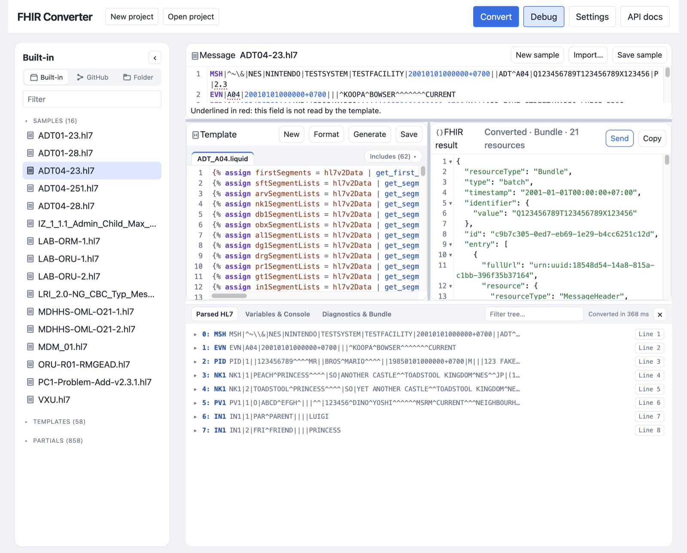
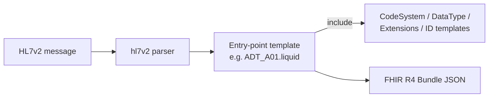

# fhir-converter-liquid

[](https://github.com/gjergjsheldija/fhir-converter-liquid/actions/workflows/ci.yml)
[](LICENSE)
[](package.json)

**HL7v2 &rarr; FHIR R4, powered by [Liquid](https://shopify.github.io/liquid/) templates.**

A standalone conversion service, API-, and template-editor-compatible with [Microsoft's FHIR Converter](https://github.com/microsoft/FHIR-Converter) template library — point it at the official Liquid templates (or your own) and get FHIR R4 bundles out.



## Contents

- [Features](#features)
- [Quick start](#quick-start)
- [Web UI](#web-ui)
- [API](#api)
- [Working with Liquid templates](#working-with-liquid-templates)
- [Configuration](#configuration)
- [Docker](#docker)
- [Project layout](#project-layout)
- [Contributing](#contributing)

## Features

**Conversion**

- HL7v2 and C-CDA → FHIR R4, with HL7v2 templates for every major trigger-event family (`ADT`, `BAR`, `DFT`, `MDM`, `OMG`, `OML`, `ORM`, `ORU`, `OUL`, `RDE`, `RDS`, `REF`, `SIU`, `VXU`) and C-CDA project packs
- Bare `\r` MLLP segment terminators and `MSH-18` character set decoding (`8859/1`, `ISO-8859-15`, `WINDOWS-1252`, `UTF-8`)
- Multi-facility HIE site packs: `conceptmaps/*.json` (with optional `"preserveSource": true` to retain local hospital codes alongside LOINC/SNOMED) and `identifiers.json` Assigning Authority rules (`MR@HOSP_A`, `byAssigner`, `bySystem`, `override`)
- Clean `FHIR Converter Liquid` Provenance narratives in generated Bundles (no `TEMPLATE_VERSION_PLACEHOLDER` strings or upstream tarball URLs)
- Per-request template overrides — test a template change against real data without touching what's stored on the server
- Diagnostics on demand: `unusedSegments` (data the template ignored), `invalidAccess` (fields the template reached for but weren't there), non-standard unmapped codes, and case-mismatched Liquid variables
- Timezone-aware date/time conversion via request header

**Editor**

- Browser workspace for message, Liquid template, and FHIR result, with syntax coloring, folding, and a Liquid formatter
- Files pane for samples, templates, and partials (starter pack, a local folder, or GitHub). Menu (Cmd-K) holds customer, settings, and docs commands
- Live conversion, plus a debug drawer: parsed HL7 or CDA tree, variable console, unused fields, case-mismatched variable warnings, and hover values on Liquid paths and HL7 fields
- Includes list grouped by folder; open a partial, or start a new one by name
- Projects: HL7 v2 or C-CDA, from the Microsoft baseline or an empty example. Open a local folder or a GitHub repo, convert and save against that project
- C-CDA editor: XML coloring, parsed CDA tree, hover paths, and expected-bundle diff
- Validate the FHIR result against `{base}/$validate`, with an optional profile URL. Send rewrites conditional creates (`If-None-Exist`) and conditional updates (`PUT`) into `urn:uuid:` transactions while stripping client `resource.id` so intra-Bundle references stay intact
- Generate maps can score the field map against an IG ConceptMap loaded in the browser. Clicking a value in the FHIR result names the Liquid include and direct HL7 source field that wrote it
- AI template generation from Settings. Paste an API key for OpenAI, Anthropic, Google Gemini, xAI (Grok), Mistral, DeepSeek, Groq, OpenRouter, or point at a local OpenAI-compatible server
- Light, dark, and system themes

**Serving & tooling**

- REST API with interactive OpenAPI/Swagger docs (`/api-docs`), plus headless project conversion at `POST /api/v1/projects/:projectId/convert/:template` (resolved under `PROJECTS_ROOT`, default `./projects`)
- `HEADLESS_RUNTIME=true` mode for cloud/production deployments (disables browser studio, folder browse, template writes, and outbound FHIR send routes with `403`; keeps `/health`, `/version`, `/metrics`, and authenticated convert routes active)
- `CONVERT_API_KEY` Bearer protection across convert and sensitive studio/management routes, with non-blocking async `5 MB`-rotated PHI-free `MSH-10` audit and failure logs
- Project CLI (`bin/convert.mjs` / `npm run convert:project`) for HL7 v2 and C-CDA single conversions or `--check-goldens` checks
- Open Integration Engine channel (`integrations/oie/hl7v2-to-fhir.xml`) with dynamic `MSH-9` routing, optional `CONVERT_API_KEY` header forwarding, and `MSA|AA` / `MSA|AE` ACK/NACK responses
- Async, queue-driven conversion over AMQP (Apache ActiveMQ Artemis via `rhea`) for pipeline integration — optional, off by default
- Prometheus metrics, structured logging, `/health` and `/version` endpoints
- Multi-stage Docker build (prod / dev / test) with a docker-compose + Makefile workflow

## Quick start

**Install**

```bash
npm ci
cp .env.example .env   # tweak PORT, CONVERSION_TIMEOUT_MS, LOG_LEVEL if needed
```

**Run**

```bash
npm start               # serves on http://localhost:2019
```

**Test**

```bash
npm test                # unit tests (mocha + nyc coverage)
npm run eslint          # lint
```

**Convert a message**

```bash
# Convert an HL7v2 ADT^A01 message using the built-in template
curl -X POST http://localhost:2019/api/v1/convert/hl7v2/ADT_A01 \
  -H "Content-Type: text/plain" \
  --data-binary @src/sample-data/hl7v2/ADT01-23.hl7
```

## Web UI

Open `http://localhost:2019`. The screenshot above is that workspace: files on the left, the HL7 message and Liquid template in the middle, the FHIR bundle on the right, and the debug drawer along the bottom.

1. Pick a sample, paste a message, or use **New sample** / **Import…** / **Save sample**. Samples you add in Built-in mode go to gitignored `src/service-samples/`, not the vendored `src/sample-data/` tree.
2. Open a template. With **Update the FHIR result as you type** on, the FHIR bundle updates as you edit either side. **Run** on the FHIR result runs a conversion immediately.
3. **Format** pretty-prints the Liquid or JSON in the active editor. **Save** writes the template to the built-in runtime tree, or into the open local project.
4. **Includes** lists the partials for the open template, grouped by folder. Click one to open it. A name that is not on disk yet opens a new tab; nothing is written until you save.
5. **Debug** opens the bottom drawer: parsed HL7, a variable console, and diagnostics (unused fields and bundle resources). Hover a Liquid path such as `firstSegments.MSH.10`, or a field in the message, to see the value conversion read.
6. **API docs** opens the Swagger UI also served at `/api-docs`.

The files pane folds Samples, Templates, and Partials, and collapses to a rail.

### Projects


**New project** creates a folder and a `fhir-converter.json` manifest.

| Choice | What you get |
| --- | --- |
| HL7 v2, Microsoft baseline | The pinned v7.0 template pack and four sample messages |
| HL7 v2, empty example | One synthetic ADT message and one Patient template |
| C-CDA, Microsoft baseline | The pinned v7.0 C-CDA template pack and one sample document |
| C-CDA, empty example | One synthetic C-CDA document and one example template |

**Open project** loads a local folder, or a GitHub repository at a ref. Conversion and includes then resolve from that project. A GitHub project is read-only here: Save explains that and does not write. A local HL7 project can later copy in the official 139 HL7 v2 sample messages.

Each feature is described on its own page from [docs/features.md](docs/features.md).

### Includes


### Settings and AI generate


**Settings** stores the theme, convert-while-typing, the timezone sent on each conversion, and AI template generation. Light, dark, and system apply as soon as you pick one. The API key stays in this browser.


**Generate** uses the provider and key from Settings and does not ask for them again. Supported providers:

| Provider | What you configure |
| --- | --- |
| OpenAI, Anthropic (Claude), Google Gemini, xAI (Grok), Mistral, DeepSeek, Groq, OpenRouter | API key. The server fills the base URL and a default model |
| Local (oMLX / Ollama) | Base URL. No API key |
| Custom (OpenAI-compatible) | Base URL and API key |

If the chosen provider needs a key and none is stored, Generate opens Settings on the key field.

### Where Save writes

| Action | Destination |
| --- | --- |
| Save, built-in templates | `src/service-templates/Hl7v2/` |
| Save, local project | That project's template folder |
| Save, GitHub project | Refused. The checkout stays read-only |
| Save sample, built-in | `src/service-samples/` (gitignored) |
| Save sample, local project | That project's samples folder |

Do not hand-edit vendored files under `src/templates/`, `src/sample-data/`, or the official expected-result fixtures. Restore them with the commands in [Working with Liquid templates](#working-with-liquid-templates).

## API

All endpoints are versioned under `/api/v1`. Full interactive reference: `GET /api-docs` (Swagger UI) / `GET /api-docs.json` (raw OpenAPI spec).

| Method | Path                                       | Description                                                                                                                  |
| ------ | ------------------------------------------ | ---------------------------------------------------------------------------------------------------------------------------- |
| GET    | `/api/v1/parsers`                          | List available source-data parsers                                                                                           |
| GET    | `/api/v1/templates`                        | List templates on the server                                                                                                 |
| GET    | `/api/v1/templates/{file}`                 | Fetch a specific template's contents                                                                                         |
| GET    | `/api/v1/sample-data`                      | List bundled sample messages                                                                                                 |
| GET    | `/api/v1/sample-data/{file}`               | Fetch a specific sample message                                                                                              |
| POST   | `/api/v1/convert/{srcDataType}`            | Convert data using an inline template (`templateBase64`, plus optional `templatesOverrideBase64`) passed in the request body |
| POST   | `/api/v1/convert/{srcDataType}/{template}` | Convert data using a template already stored on the server                                                                   |
| PUT    | `/api/v1/templates/{file}`                 | Save a template into the runtime template tree                                                                               |
| PUT    | `/api/v1/sample-data/hl7v2/{file}`         | Save a user sample message                                                                                                   |
| GET    | `/api/v1/ai/providers`                     | List AI providers (label, format, whether a key is required)                                                                 |
| POST   | `/api/v1/templategenerate`                 | Generate a Liquid template from a message. A known provider takes `provider` and `apiKey`; the server supplies the URL and default model |
| POST   | `/api/v1/projects`                         | Create a local project                                                                                                       |
| POST   | `/api/v1/projects/open`                    | Open a local project folder                                                                                                  |
| POST   | `/api/v1/projects/open-github`             | Open a GitHub project read-only                                                                                              |
| POST   | `/api/v1/projects/convert`                 | Convert using the open project's templates                                                                                   |
| POST   | `/api/v1/projects/{projectId}/convert/{template}` | Headless conversion against `:projectId` under `PROJECTS_ROOT` (applies project templates, `declaredSegments`, and `sitePack`) |
| PUT    | `/api/v1/projects/file`                    | Save a file into a local project                                                                                             |
| POST   | `/api/v1/projects/official-samples`        | Copy the official 139 HL7 v2 samples into a local project                                                                    |
| POST   | `/api/v1/convert/ccda`                     | Convert a C-CDA document with an inline template                                                                             |
| POST   | `/api/v1/fhir/validate`                    | POST the FHIR result to `{base}/$validate`. A non-empty `profile` is sent as the `profile` query parameter |
| POST   | `/api/v1/fhir/send`                        | POST the FHIR result. `conditional: true` or `update: true` builds a `urn:uuid:` transaction Bundle. Both together is 400 |
| GET    | `/api/v1/conversions/failures`             | Recent failed conversions, plus success and failure counts since process start |
| GET    | `/health`                                  | Liveness check                                                                                                               |
| GET    | `/version`                                 | Build version                                                                                                                |

Useful query/header options on the convert endpoints:

| Name                  | Where  | Effect                                                                                   |
| --------------------- | ------ | ---------------------------------------------------------------------------------------- |
| `unusedSegments=true` | query  | Include segments present in the source but never accessed by the template               |
| `invalidAccess=true`  | query  | Include fields the template tried to read that didn't exist                              |
| `debug=true`          | query  | Include `debugInfo` (timing, parsed HL7, and template scopes) for the editor drawer      |
| `timezone`            | header | Normalize date/times to a given IANA/offset timezone, e.g. `America/New_York` or `+0400` |

```bash
curl -X POST "http://localhost:2019/api/v1/convert/hl7v2/ADT_A01?unusedSegments=true&invalidAccess=true" \
  -H "Content-Type: text/plain" \
  -H "timezone: Europe/Berlin" \
  --data-binary @message.hl7
```

## Working with Liquid templates

Conversion is entirely template-driven: an **entry-point template** (one per message type, e.g. `ADT_A01.liquid`) renders the FHIR bundle by pulling in smaller, reusable **component templates** via Liquid's `include`.



**Where they live:**

| Path                           | Contents                                                                                                                                  |
| ------------------------------ | ----------------------------------------------------------------------------------------------------------------------------------------- |
| `src/templates/Hl7v2/`         | Microsoft's base HL7v2 Liquid templates (entry points + `CodeSystem`, `DataType`, `Extensions`, `ID` includes)                            |
| `src/service-templates/Hl7v2/` | The templates actually served/used at runtime — regenerated from `templates/` on startup by `src/init-service.js`; edit here to customize |
| `src/sample-data/hl7v2/`       | Sample messages used by the web UI and for local testing                                                                                  |

**This project is template-compatible with [microsoft/FHIR-Converter](https://github.com/microsoft/FHIR-Converter)** — because it uses the same Liquid syntax and the same `hl7v2FHIR`-style helper filters, you can:

- Drop newer or additional templates straight from Microsoft's repo into `src/service-templates/Hl7v2/` — no code changes needed
- Author your own templates the same way: start from an existing `.liquid` file, use `` to reuse the shared building blocks, and reference [Liquid's own syntax docs](https://shopify.github.io/liquid/) plus the [HL7 v2-to-FHIR mapping project](https://confluence.hl7.org/display/OO/2-To-FHIR+Project) for field-level guidance
- Iterate fast with the web UI (instant preview) or with `templatesOverrideBase64` on `POST /api/v1/convert/{srcDataType}` (test one or more templates against real data with nothing written to disk)
- Use `unusedSegments`/`invalidAccess` on a convert call to spot exactly what your template is missing or mis-referencing in the source message

To restore the bundled HL7v2 templates and official expected-result fixtures from the exact Microsoft revision pinned in `test/e2e-test/liquid-fixtures/UPSTREAM_VERSION.md`, run:

```bash
make sync-templates
make sync-expected-results
make sync-hl7v2-samples
```

The first command replaces both the source template directory and the generated runtime copy. The second replaces the test suite's expected JSON files with Microsoft's checked-in results. The third replaces the UI's bundled HL7v2 sample messages with Microsoft's full sample set. All three verify the pinned commit and copied contents. Do not edit vendored Liquid files, expected results, or bundled sample messages by hand.

## Configuration

`.env` (see `.env.example`):

| Variable                | Default      | Purpose                                                                                                             |
| ----------------------- | ------------ | ------------------------------------------------------------------------------------------------------------------- |
| `PORT`                  | `2019`       | HTTP port                                                                                                           |
| `CONVERSION_TIMEOUT_MS` | `30000`      | Per-message conversion timeout                                                                                      |
| `LOG_LEVEL`             | `info`       | Winston log level                                                                                                   |
| `CONVERT_API_KEY`       | unset        | Require `Authorization: Bearer <key>` on convert and sensitive studio/management routes                             |
| `HEADLESS_RUNTIME`      | `false`      | Disable browser studio, browse, write, and outbound FHIR routes (`403`); keep health, metrics, and convert active   |
| `PROJECTS_ROOT`         | `./projects` | Base folder used to resolve `:projectId` on `POST /api/v1/projects/:projectId/convert/:template`                    |

`config/default.json` (loaded via `nconf`, overridable by env vars) controls the optional AMQP integration:

| Key                                      | Purpose                                                 |
| ---------------------------------------- | ------------------------------------------------------- |
| `enable_message_broker`                  | Turn on queue-driven conversion (off by default)        |
| `input_queue_name` / `output_queue_name` | Queues consumed/produced when enabled                   |
| `message_broker.*`                       | Broker host/port/credentials                            |
| `max_retries`                            | Retry attempts for a failed conversion before giving up |

## Docker

```bash
make build   # builds runner + dev images
make start   # docker-compose up the runner image on :2019
make test    # runs the test-stage image (lint + unit tests)
```

## Project layout

```
src/
├── routes.js               # Express routes + Swagger annotations
├── lib/
│   ├── parsers/             # hl7v2 source parser
│   ├── liquid-converter/    # Liquid rendering engine
│   ├── projects/            # Local and GitHub project open, convert, and save
│   ├── ai/                  # Template-generation clients (OpenAI-compatible, Anthropic, Gemini)
│   ├── outputProcessor/     # Post-processing of rendered output into FHIR JSON
│   ├── workers/             # Worker-pool for CPU-bound conversion
│   └── message-broker/      # Optional AMQP queue integration
├── templates/Hl7v2/         # Base Microsoft Liquid templates
├── service-templates/       # Templates served at runtime (regenerated from templates/)
├── sample-data/             # Bundled sample HL7v2 messages
└── static/                  # Web UI (HTML/CSS/JS, CodeMirror editor, projects, debug drawer)
```

## Contributing

See [CONTRIBUTING.md](CONTRIBUTING.md).

## License

MIT — see [LICENSE](LICENSE). Built on template and conversion code from Microsoft's [FHIR Converter](https://github.com/microsoft/FHIR-Converter), also MIT-licensed.
