# Features

The editor at `http://localhost:2019` authors Liquid maps for HL7 v2 and C-CDA, converts them to FHIR R4, and can check or send the result. Built-in mode is HL7 v2. C-CDA runs inside a project.

## C-CDA projects

**New project** asks for a family and a starting point.

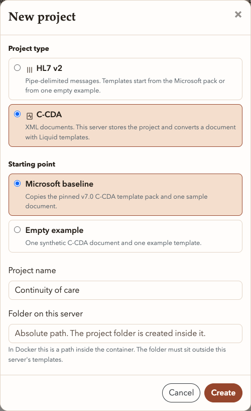

| Choice | What you get |
| --- | --- |
| HL7 v2, Microsoft baseline | The pinned v7.0 HL7 v2 template pack and four sample messages |
| HL7 v2, empty example | One synthetic ADT message and one Patient template |
| C-CDA, Microsoft baseline | The pinned v7.0 C-CDA template pack and one sample document. The project opens `templates/Ccda/CCD.liquid` |
| C-CDA, empty example | One synthetic C-CDA document and `templates/Ccda/Example.liquid` |

The baseline pin is Microsoft FHIR Converter `v7.0`, commit `253307fe6063a42b024ef7dbeb6aae157f1c2f61`. The sample document in a new project is synthetic. Microsoft publishes 22 C-CDA expected bundles in that commit. This engine does not match them yet, so those files are not vendored here.

Open the project and the message editor uses XML coloring, conversion uses the C-CDA parser, and the debug drawer label becomes **Parsed CDA**. **Built-in** returns to HL7 v2. A project whose manifest lists both families shows a **Project family** control and loads that family's files.

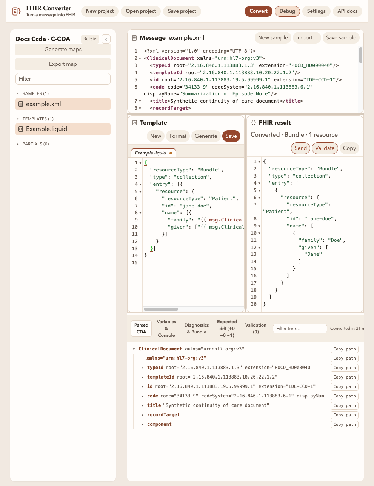

In a template the document is `msg`:

| In the document | In Liquid |
| --- | --- |
| Attribute `id root="1.2.3"` | `msg.ClinicalDocument.id.root` |
| Text of `<title>` | `msg.ClinicalDocument.title._` |
| Prefixed element `sdtc:raceCode` | `msg.ClinicalDocument...sdtc_raceCode` |
| Repeated child | An array. The second `given` is `given[1]` |

**Copy path** on a Parsed CDA row copies that Liquid path.

Hover a tag, attribute, or text node in the message. The tooltip shows the same path and the value.

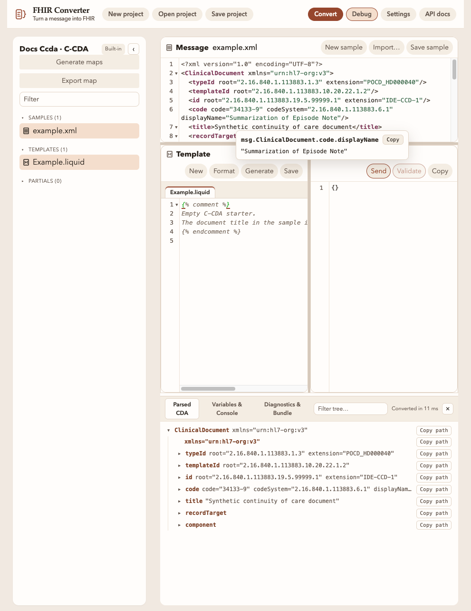

Put a FHIR bundle beside a sample to compare them. For `samples/ccda/example.xml` the file is `tests/expected/example.json`. For an HL7 sample `ADT04-23.hl7` it is `tests/expected/ADT04-23.json`. After conversion the drawer adds **Expected diff** and counts added, removed, and changed resources. A resource matches another by type and id, so a different id counts as one added and one removed.

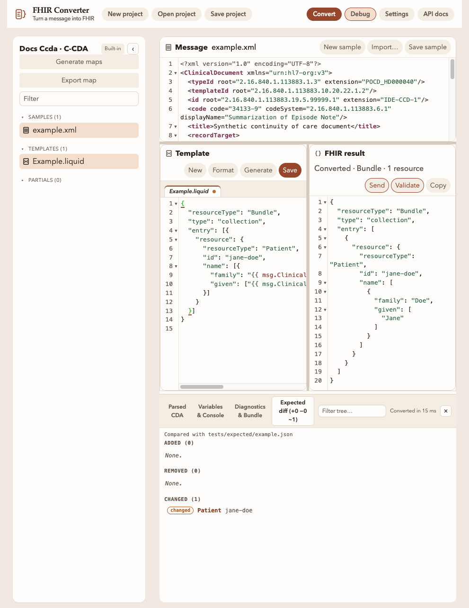

`POST /api/v1/convert/ccda` converts a document with an inline template. `POST /api/v1/projects/convert` uses the open project. A project whose only family is `ccda` converts as C-CDA. Any other project converts as HL7 v2. A missing partial is read from the built-in template tree. A file in the project wins.

## Validate

**Validate**, next to **Send** on the FHIR result, posts that resource to `{base}/$validate`. Set the base URL under **Settings → FHIR server**. Convert does not call the FHIR server.

A success, or an OperationOutcome from the server, opens the **Validation** tab and lists the issues. A server that cannot be reached shows the request error there.

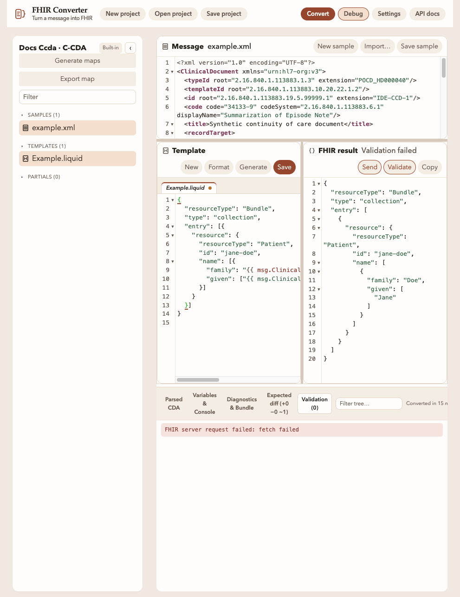

```bash
curl -X POST http://localhost:2019/api/v1/fhir/validate \
  -H "Content-Type: application/json" \
  -d '{"baseUrl":"http://127.0.0.1:8080/fhir","resource":{"resourceType":"Patient","id":"example"}}'
```

The same `baseUrl` accepts `Authorization` bearer or basic username and password fields, matching **Send**.

## Conditional send

**Settings → FHIR server → Match existing resources by identifier** is off until you turn it on. It is stored in this browser as `fhirConditional`.

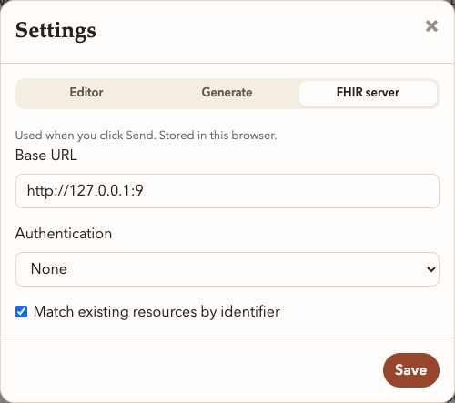

With it off, **Send** posts the result as converted. With it on, a `batch` or `collection` Bundle is sent as one `transaction`. Each entry that has an identifier with a system and a value is a conditional create: `POST` to the resource type, with `If-None-Exist` set to `identifier={system}|{value}`. Other resources are posted unchanged. The editor still makes one request.

```bash
curl -X POST http://localhost:2019/api/v1/fhir/send \
  -H "Content-Type: application/json" \
  -d '{"baseUrl":"http://127.0.0.1:8080/fhir","conditional":true,"resource":{"resourceType":"Bundle","type":"batch","entry":[]}}'
```

A second checkbox, **Update the resource that already has this identifier**, is also off by default. It sends one transaction. An entry whose first identifier has a system and a value becomes `PUT {resourceType}?identifier={system}|{value}`. Other entries stay `POST`. Checking either checkbox clears the other. A request that sets both `conditional` and `update` is rejected with `Choose create or update, not both.`

**Profile canonical URL** on the same FHIR server tab is sent only with Validate, as `?profile=` on `{base}/$validate`. An empty field leaves the URL unchanged. Convert still does not call the FHIR server.

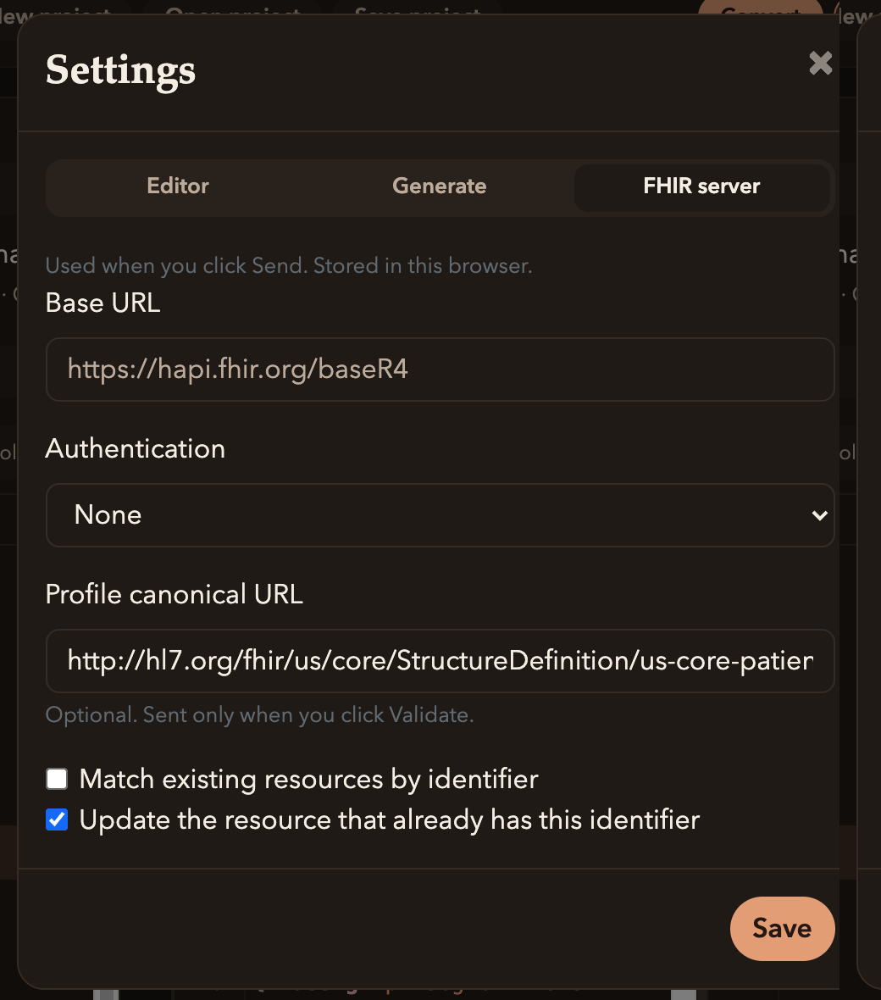

## IG coverage

**Generate maps** writes the field-map files and returns the Bundle of ConceptMaps. Next to that button, **IG ConceptMap JSON file** reads one ConceptMap, or a Bundle of them, in the browser. It is not uploaded.

With no file selected the score says **No IG ConceptMap loaded**. With a file it says `Shared N · Only in template N · Only in IG N`. A mapping matches when source system, source code, target system, and the first target code are the same.

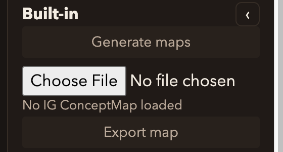

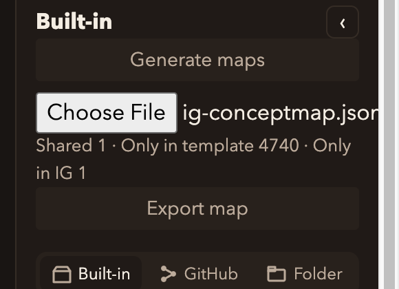

## Unmapped codes

After a local project conversion, Diagnostics lists Codings that no site-pack ConceptMap rewrote, as `system | code` plus the path. An empty list says **No unmapped codes**. GitHub conversions do not add the list. The FHIR resource itself does not gain an `unmapped` property.

## Result lineage

With debug on, clicking a string or number in the FHIR result shows the include that wrote it, for example `Resource/_MessageHeader.liquid`.

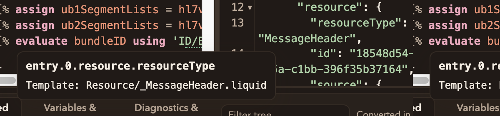

A value with no recorded include says **No source recorded**. The source field is blank: the trace names the template and does not guess which variable that template read. Debug off does not add the trace, and the FHIR result is unchanged.

## Declared segments

A local HL7 v2 project may contain `structures/segments.txt`, one segment id per line. Blank lines and `#` comments are ignored. When debug is on, `debugInfo.undeclaredSegments` lists segment ids from the message that are not on that list. `MSH` is never listed. A missing file turns the check off. Conversion still succeeds.

## Failure log

A non-200 response from `POST /api/v1/convert/{srcDataType}` or `POST /api/v1/projects/convert` appends one row to `data/conversion-failures.jsonl`. The row has the time, the template name, the error, and MSH-10 when the message has one. The raw message is not stored.

```bash
curl http://localhost:2019/api/v1/conversions/failures
```

The response is `{failures, failed, succeeded}`. `failed` and `succeeded` count since the process started. Validate and Send are not counted.

## Convert API key

Set `CONVERT_API_KEY` in the server environment to require `Authorization: Bearer <key>` on the three convert routes. When the variable is empty, those routes stay open. Settings has **Convert API key**. A stored key is sent only on convert requests. Validate, Send, and the page itself stay open.

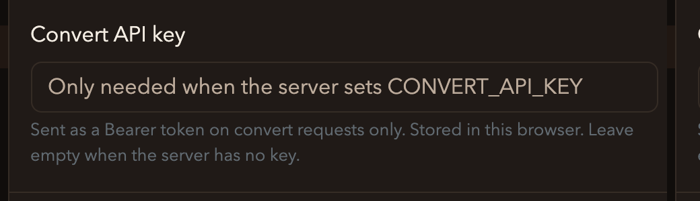

Each convert attempt, including a 401, appends `{at, status, template, controlId}` to `data/conversion-audit.jsonl`. A 401 does not read the message, so `controlId` is empty. The line does not contain the body or the key.

## Site pack

A local project can rewrite the FHIR result after conversion. GitHub projects do not apply a site pack.

| File | Effect |
| --- | --- |
| `conceptmaps/*.json` | FHIR ConceptMap files, read only in that folder. A Coding whose `system` and `code` match a group is rewritten to `group.target` and the first `element.target` code. A string `display` is copied too |
| `identifiers.json` | Map of identifier type code to a system URI. An Identifier that has a `value` and no `system` receives the system for its `type.coding[].code` |

A missing directory or file is an empty pack. Invalid JSON, or a JSON value that is not an object, fails the conversion with status 400. The pack is also applied by the project CLI.

## Project CLI

`npm run convert:project` runs one conversion against a local project and prints the FHIR JSON. The project path must be absolute. The template name may omit `.liquid`.

```bash
npm run convert:project -- \
  --project /absolute/path/to/project \
  --message /absolute/path/to/message.hl7 \
  --template ADT_A01
```

`--check-goldens` walks `tests/expected/*.json` in sorted order. Each file is compared with `<samples>/<basename>.hl7`, using `--template` or the manifest startup template. The comparison is the same one the official HL7 suite uses. An empty expected directory exits 0. The first mismatch prints that basename on stderr and exits 1.

```bash
npm run convert:project -- \
  --project /absolute/path/to/project \
  --check-goldens
```

## Open Integration Engine

`integrations/oie/hl7v2-to-fhir.xml` is an OIE channel. OIE receives HL7 v2 on its TCP listener and posts `{"srcData","template"}` to `http://127.0.0.1:2019/api/v1/convert/hl7v2`. This server does not listen for MLLP. The README shows an ACK whose MSA-2 is the inbound MSH-10. The channel file itself does not yet map that control id, and it does not archive the raw message. Setup and the sample ACK are in [integrations/oie/README.md](../integrations/oie/README.md).
