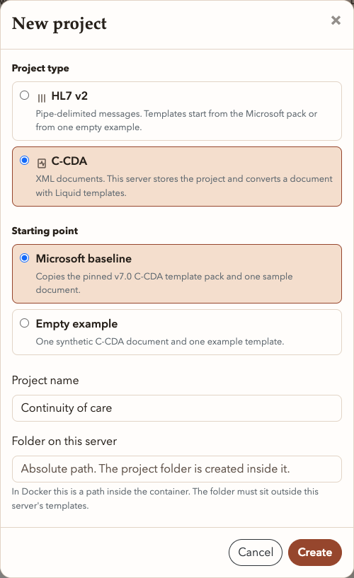
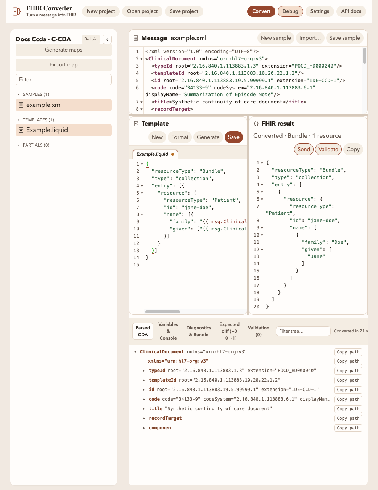
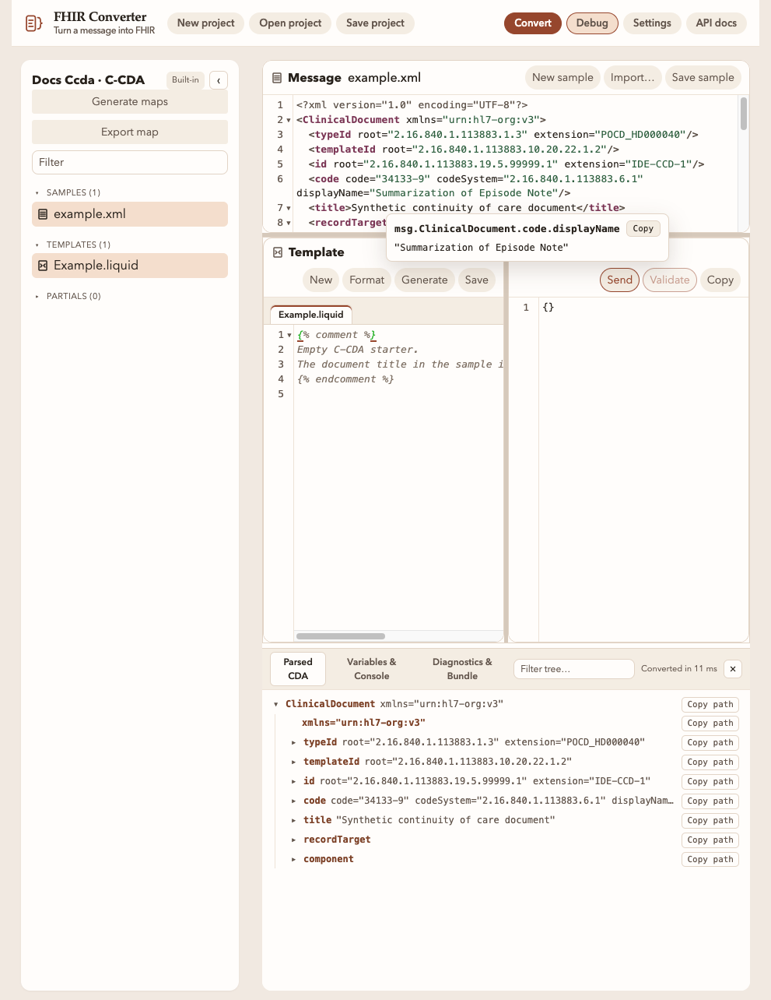
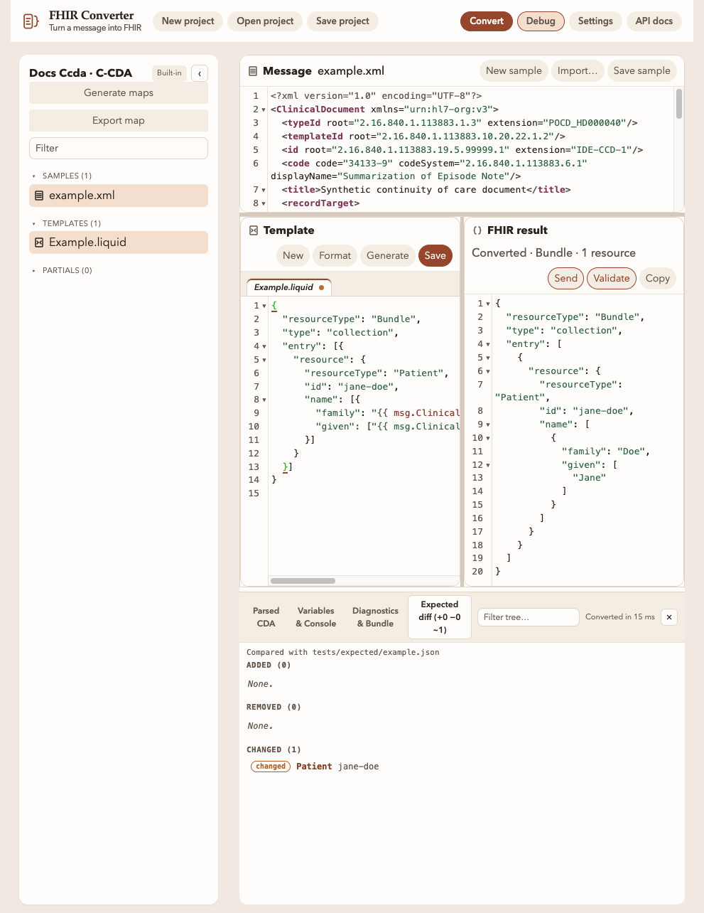

# C-CDA projects

[Features](../features.md)

C-CDA conversion runs inside a project. Built-in mode stays HL7 v2. **New project** asks for a family and a starting point.

| Choice | What you get |
| --- | --- |
| HL7 v2, Microsoft baseline | The pinned v7.0 HL7 v2 template pack and four sample messages |
| HL7 v2, empty example | One synthetic ADT message and one Patient template |
| C-CDA, Microsoft baseline | The pinned v7.0 C-CDA template pack and one sample document. The project opens `templates/Ccda/CCD.liquid` |
| C-CDA, empty example | One synthetic C-CDA document and `templates/Ccda/Example.liquid` |

The baseline pin is Microsoft FHIR Converter `v7.0`, commit `253307fe6063a42b024ef7dbeb6aae157f1c2f61`. The sample document written into a new project is synthetic. It is not one of Microsoft's sample documents. Microsoft publishes 22 C-CDA expected bundles in that commit. This engine does not match them yet, so those files are not vendored here and a new project does not include an expected bundle for the sample.

If `templates/Ccda/CCD.liquid` is missing on the server, creating a C-CDA baseline project fails and the new directory is removed. The message is `The C-CDA baseline is not installed on this server.`

## What changes in the editor

Open the project and the message editor uses XML coloring, conversion uses the C-CDA parser, and the debug drawer label becomes **Parsed CDA**. **Built-in** returns to HL7 v2. A project whose manifest lists both families shows a **Project family** control and loads that family's files.

A project whose only family is `ccda` converts as C-CDA. Any other project converts as HL7 v2. `POST /api/v1/convert/ccda` converts a document with an inline template. `POST /api/v1/projects/convert` uses the open project. A missing partial is read from the built-in template tree. A file in the project wins.

## How the document appears in Liquid

The parsed document is the variable `msg`. The parser does not keep XML attributes behind `@`, and it does not keep element text as a separate `#text` node.

| In the document | In Liquid |
| --- | --- |
| Attribute `id root="1.2.3"` | `msg.ClinicalDocument.id.root` |
| Text of `<title>` | `msg.ClinicalDocument.title._` |
| Prefixed element `sdtc:raceCode` | `msg.ClinicalDocument...sdtc_raceCode` |
| Repeated child | An array. The second `given` is `given[1]` |

**Copy path** on a Parsed CDA row copies that Liquid path. Hover a tag, attribute, or text node in the message and the tooltip shows the same path and the value.

## Expected diff

Put a FHIR bundle beside a sample to compare them. For `samples/ccda/example.xml` the file is `tests/expected/example.json`. For an HL7 sample `ADT04-23.hl7` it is `tests/expected/ADT04-23.json`. After conversion the drawer adds **Expected diff** and counts added, removed, and changed resources. A resource matches another by type and id, so a different id counts as one added and one removed.

