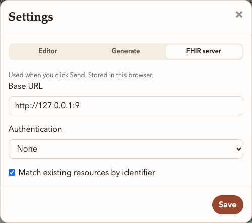
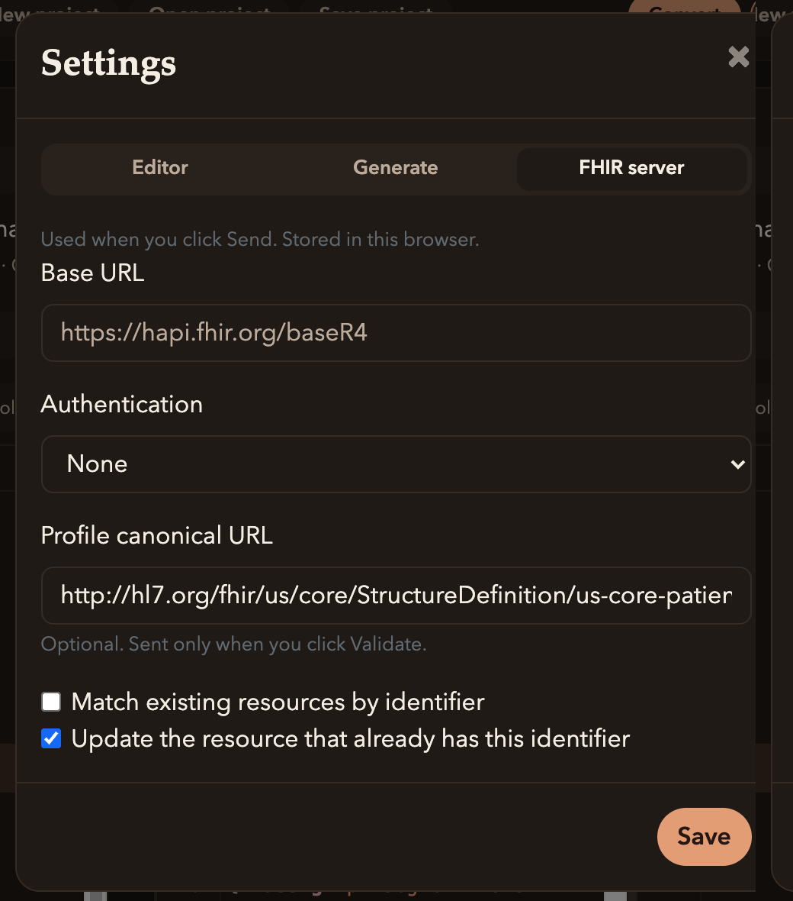

# Conditional send

[Features](../features.md)

**Send** posts the FHIR result to the base URL in **Settings → FHIR server**. With both checkboxes off, the result is posted as converted. A Bundle whose type is already `transaction` or `batch` is posted to the base URL. Any other resource is posted to `{base}/{resourceType}`.

Two checkboxes change a `batch` or `collection` Bundle before that post. Both are off until you turn one on. They are stored in this browser. Checking one clears the other. The editor still makes one request.





## Create when the identifier is new

**Match existing resources by identifier** is stored as `fhirConditional`. With it on, a `batch` or `collection` Bundle is copied to `type: transaction`. Each entry is rewritten:

| The entry resource | Request |
| --- | --- |
| First `identifier` has a non-empty `system` and `value` | `POST {resourceType}` with `If-None-Exist: identifier={system}\|{value}` |
| Anything else | `POST {resourceType}` |

`system` and `value` are URL-encoded separately, then joined with `|`. Only the first identifier is used. A Bundle that is already a `transaction`, a `searchset`, or a single resource is posted unchanged. The copy is not written back into the result pane.

```bash
curl -X POST http://localhost:2019/api/v1/fhir/send \
  -H "Content-Type: application/json" \
  -d '{"baseUrl":"http://127.0.0.1:8080/fhir","conditional":true,"resource":{"resourceType":"Bundle","type":"batch","entry":[]}}'
```

## Update the resource that already has this identifier

**Update the resource that already has this identifier** is stored as `fhirUpdate`. It also copies a `batch` or `collection` Bundle to one `transaction`. An entry whose first identifier has a system and a value becomes:

```text
PUT {resourceType}?identifier={system}|{value}
```

Other entries stay `POST {resourceType}`. This is a conditional update: the FHIR server selects the resource by that identifier search. There is no check of message time or of whether the existing resource is newer.

A request that sets both `conditional` and `update` is rejected with status 400 and `Choose create or update, not both.` The FHIR server is not called.

## Entry IDs and internal references

Both **Match existing resources by identifier** (`If-None-Exist` conditional `POST`) and **Update the resource that already has this identifier** (conditional `PUT`) rewrite entry identities in the outgoing `transaction` Bundle:

1. Each entry with a `resource.id` is promoted to `fullUrl: "urn:uuid:<id>"` (unless its `fullUrl` already starts with `urn:uuid:`).
2. Internal relative references of the form `ResourceType/<id>` anywhere in the Bundle — such as `Encounter.subject`, `Observation.subject`, `DiagnosticReport.result`, and `Provenance.target` — are rewritten to `urn:uuid:<id>`.
3. Client `resource.id` is stripped from entries sent via `POST` or conditional `PUT`.

FHIR R4 servers (HAPI FHIR, Azure Health Data Services, Firely Server, Medplum) reject client-supplied `resource.id` on `POST` or replace it with an existing or server-assigned ID during conditional match and conditional update. Rewriting entries and references to `urn:uuid:<id>` lets the server resolve every intra-Bundle reference to the matched or newly assigned resource ID without broken links.

## What Send does not do

Send does not call `$validate`, and it does not read **Profile canonical URL**. Authentication is the bearer token or the basic username and password on the FHIR server tab. A URL that is not `http` or `https`, or a result with no `resourceType`, fails before the request is sent. A FHIR server error comes back as 400 with `FHIR server returned {status}.`
