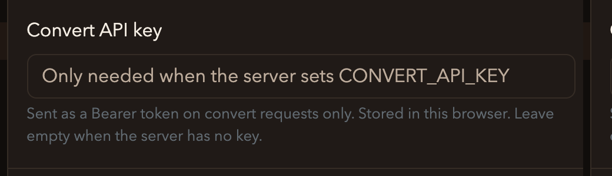

# Convert API key

[Features](../features.md)

Set `CONVERT_API_KEY` in the server environment to require a Bearer token on the three convert routes:

- `POST /api/v1/convert/{srcDataType}`
- `POST /api/v1/convert/{srcDataType}/{template}`
- `POST /api/v1/projects/convert`

The variable is read on each request. When it is unset or empty, those routes stay open and any `Authorization` header is ignored. When it is set, the header must be exactly `Bearer ` followed by the variable's value. `bearer`, a missing prefix, and a trailing space are rejected. The comparison does not stop at the first differing character.

A rejected request returns 401 and `Convert API key is required.` The handler does not read the body.

Validate, Send, the editor page, and every other route stay open. The key is not required to look at templates or to post a result to a FHIR server.

## The editor

**Settings → Editor → Convert API key** is stored in this browser as `convertApiKey`. A stored value is sent as `Authorization: Bearer …` on convert requests only.



Leave the field empty when the server has no key. A key saved in the browser is not sent to Validate or Send.

## Audit line

Each attempt on the inline convert route and the project convert route appends one line to `data/conversion-audit.jsonl`:

```json
{"at":"2026-11-20T09:00:00.000Z","status":200,"template":"ADT_A01","controlId":"MSG00001"}
```

| Field | Meaning |
| --- | --- |
| `at` | Time the line was written, UTC |
| `status` | HTTP status of the attempt, including 401 |
| `template` | Template name when the request was accepted and named one. Empty on a 401 for the inline and project routes |
| `controlId` | MSH-10 when the body was read and the message has one. Empty on a 401, because the body is not read |

The line has no message body and no key. A 401 on the stored-template route can still name the template, because the name is in the URL. Success and failure on that stored-template route are not appended. A write error while appending the line does not change the conversion response.

The process access log is separate and can still contain the request body, including a 401.
