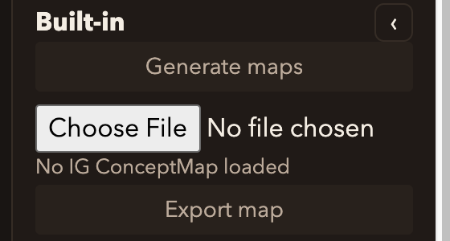
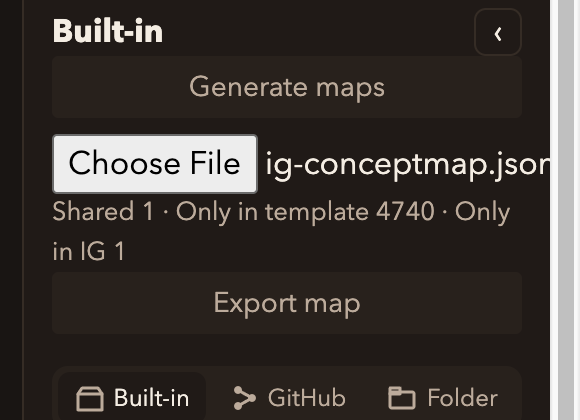

# IG coverage

[Features](../features.md)

**Generate maps** reads the HL7 v2 templates in the current folder and writes three files: a Markdown table, an HTML table, and a FHIR Bundle of ConceptMaps. In built-in mode those files go to `docs/mappings/`. In a local project or a chosen folder they go to a `mappings` directory inside that template folder. GitHub browsing cannot generate maps, because the generator reads a folder on this server.

The write response includes the Bundle as `conceptMap`. The browser keeps that Bundle and scores it against a guide you choose locally.

## The guide file

Next to **Generate maps** is **IG ConceptMap JSON file**. The file is read in the browser. It is not uploaded and it is not saved. It may be one ConceptMap, or a Bundle whose entries are ConceptMaps.



Until **Generate maps** has succeeded, the score line stays empty. After a map exists and no guide is loaded, the line says **No IG ConceptMap loaded**. A guide that has no ConceptMap groups shows the same sentence.

## How a mapping matches

Each mapping is the tuple `source system`, `source code`, `target system`, and the first `element.target` code. Two mappings count as the same only when all four are equal. Later targets on the same element are ignored. The score is:

```text
Shared N · Only in template N · Only in IG N
```

`Shared` is the number of tuples present on both sides. `Only in template` is the remainder of the generated map. `Only in IG` is the remainder of the guide.



The picture is the built-in HL7 v2 pack compared with a guide that contains one real mapping from that pack (`MSH-3` to `Provenance.entity.what.reference`) and one code the pack does not have. The generated map has 4741 mappings, so the line is `Shared 1 · Only in template 4740 · Only in IG 1`.

**Export map** is separate. It downloads a zip and does not update this score.
