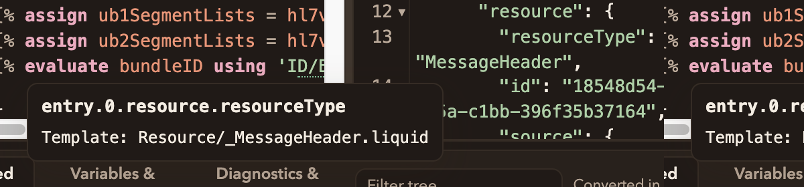

# Result lineage

[Features](../features.md)

With debug on, a conversion records which `` wrote each string or number in the FHIR result, along with any HL7 fields read directly during that partial's render span. Click a value in the result pane to inspect its origin.

In that picture the click is `entry.0.resource.resourceType`, and the include is `Resource/_MessageHeader.liquid`.

## What is recorded

Templates write JSON text. While debug is on, the engine records the output span written by each include and tracks HL7 segment/field accesses performed directly within that span. After the root template finishes, each string and number in the final resource is matched to the innermost include whose span contains the value.

A row is `{outputPath, template, sourcePath}`:

- `outputPath` is the path in the FHIR result, such as `entry.0.resource.resourceType`.
- `template` is the include file that emitted the value.
- `sourcePath` lists the HL7 source field path when the partial read HL7 fields directly during that span (for example `PID.5.1`). When a value is a fixed literal in the template (such as `"MessageHeader"`) or came from a precomputed variable without a direct HL7 read in that span, `sourcePath` stays empty rather than guessing by string equality.

Clicking a value that no row covers shows **No source recorded**. The lookup uses the longest recorded path that is equal to the clicked path or is a prefix of it on a dot boundary.

## Case-mismatched Liquid variables

With debug on, the **Problems** tab in the Debug drawer also checks undefined variable reads against variables currently in scope. When a template references a name that differs only by letter case from an existing variable — for example reading `VisitId` when `visitId` is defined — **Problems** flags the mismatch instead of silently rendering an empty value.

## What debug off does

Debug off omits `debugInfo`, including `lineage` and variable diagnostics. The FHIR resource is the same either way. Lineage is not a property of the resource, and it is not sent to a FHIR server.
