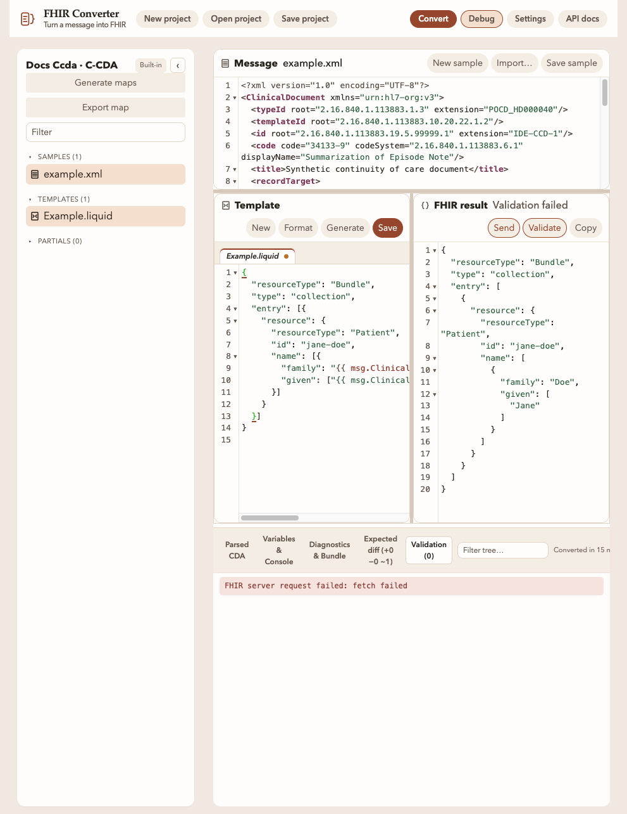

# Validate

[Features](../features.md)

**Validate**, next to **Send** on the FHIR result, posts that resource to a FHIR server's `$validate` operation. Convert does not call the FHIR server. Validate does not change the result in the editor.

Set the base URL under **Settings → FHIR server**. The URL must start with `http://` or `https://`. A trailing slash is removed, then `/$validate` is appended. Bearer and basic authentication on that tab are sent the same way **Send** sends them.



## Profile

**Profile canonical URL** on the same tab is optional and is stored in this browser as `fhirProfile`. It is sent only when you click Validate. An empty field leaves the URL as `{base}/$validate`. A non-empty value is trimmed and added as the `profile` query parameter:

```text
{base}/$validate?profile=http%3A%2F%2Fhl7.org%2Ffhir%2Fus%2Fcore%2FStructureDefinition%2Fus-core-patient
```

The profile is not stored on the server and is not added to a convert request.

## What comes back

The editor posts the current FHIR result as `application/fhir+json`. A success, or an OperationOutcome from the server, opens the **Validation** tab and lists `OperationOutcome.issue`. A server that cannot be reached shows the request error there. A non-success HTTP status from the FHIR server is returned to the editor as 400, with the OperationOutcome or a short excerpt of the body.

```bash
curl -X POST http://localhost:2019/api/v1/fhir/validate \
  -H "Content-Type: application/json" \
  -d '{"baseUrl":"http://127.0.0.1:8080/fhir","profile":"http://hl7.org/fhir/us/core/StructureDefinition/us-core-patient","resource":{"resourceType":"Patient","id":"example"}}'
```

Omit `profile`, or send it as an empty string, to validate without a profile. A result with no `resourceType` is rejected before the FHIR server is called.
