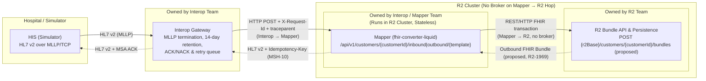
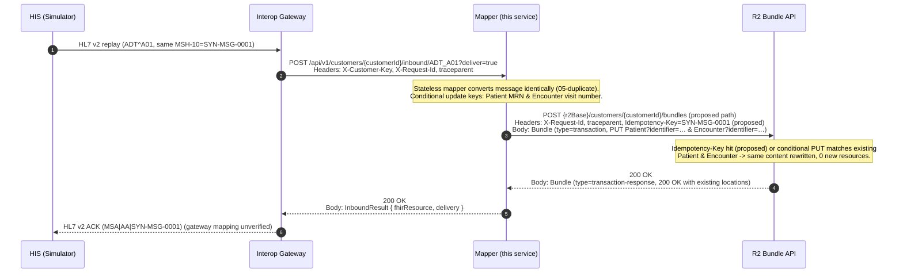

# Mapper-to-R2 Sequence Flows & Ownership

> **Status:** Spec `specs/r2-boundary/05-sequence-diagrams.md` (2026-11-27)
>
> Grounded in `docs/r2-contract/mapper-to-r2.md` and the current codebase (`src/routes/customers.routes.js`, `src/lib/customers/customerPipeline.js`, `src/lib/fhir/sendResource.js`, `src/middleware/requestContext.js`, `src/lib/hl7v2/sendHl7v2.js`). Steps not yet implemented in code or still under agreement are explicitly marked **`(proposed)`**. Exact Interop gateway HL7 v2 ACK/NACK construction is **unverified** in this repository.

---

## 0. Top-Level Ownership Overview



---

## 1. Success (Inbound HL7 v2 → FHIR Transaction → ACK `AA`)

```mermaid
sequenceDiagram
    autonumber
    participant HIS as HIS (Simulator)
    participant GW as Interop Gateway
    participant MAP as Mapper (this service)
    participant R2 as R2 Bundle API

    HIS->>GW: HL7 v2 (ADT^A01, MSH-10=SYN-MSG-0001)
    GW->>MAP: POST /api/v1/customers/{customerId}/inbound/ADT_A01?deliver=true<br/>Headers: X-Customer-Key, X-Request-Id, traceparent, timezone
    Note over MAP: requestContextMiddleware validates/echoes X-Request-Id & traceparent.<br/>runCustomerInbound renders Liquid + site pack (FHIR R4 today; R4B open in R2-1967).
    MAP->>R2: POST {r2Base}/customers/{customerId}/bundles (proposed path)<br/>Content-Type: application/fhir+json<br/>Headers: Auth (proposed), X-Request-Id, traceparent, Idempotency-Key (proposed)<br/>Body: FHIR Bundle (type=transaction, conditional PUT on identifiers)
    R2-->>MAP: 200 OK (application/fhir+json)<br/>Body: Bundle (type=transaction-response, 201/200 per entry)
    MAP-->>GW: 200 OK (X-Request-Id echoed)<br/>Body: InboundResult { fhirResource, delivery }
    GW-->>HIS: HL7 v2 ACK (MSA|AA|SYN-MSG-0001) (gateway mapping unverified)
```

---

## 2. Duplicate (Same `MSH-10` Re-sent → Conditional Update Matches → ACK `AA`)



---

## 3. Rejected (R2 Returns `422` → Terminal `OperationOutcome` → NACK `AE`, No Retry)

```mermaid
sequenceDiagram
    autonumber
    participant HIS as HIS (Simulator)
    participant GW as Interop Gateway
    participant MAP as Mapper (this service)
    participant R2 as R2 Bundle API

    HIS->>GW: HL7 v2 (valid framing, fails R2 business/FHIR validation)
    GW->>MAP: POST /api/v1/customers/{customerId}/inbound/{template}?deliver=true<br/>Headers: X-Customer-Key, X-Request-Id, traceparent
    MAP->>R2: POST {r2Base}/customers/{customerId}/bundles (proposed path)<br/>Body: Bundle (type=transaction)
    R2-->>MAP: 422 Unprocessable Entity<br/>Body: OperationOutcome (validation error)
    Note over MAP: No retry on 400/422.<br/>Today: sendResource.js collapses R2 422 -> HTTP 400 OperationOutcome.<br/>Proposed: preserve HTTP 422 OperationOutcome (phase=delivery, detail=R2 body).
    MAP-->>GW: 422 Unprocessable Entity (proposed; 400 today)<br/>Body: OperationOutcome { resourceType, issue, requestId, phase: "delivery", detail }
    Note over GW: Terminal error -> do not retry.
    GW-->>HIS: HL7 v2 NACK (MSA|AE|<MSH-10>) (gateway mapping unverified)
```

---

## 4. R2 Unavailable (`5xx` / Timeout → Retry & 14-Day Retention)

```mermaid
sequenceDiagram
    autonumber
    participant HIS as HIS (Simulator)
    participant GW as Interop Gateway
    participant MAP as Mapper (this service)
    participant R2 as R2 Bundle API

    HIS->>GW: HL7 v2 (MSH-10=SYN-MSG-0042)
    GW->>MAP: POST /api/v1/customers/{customerId}/inbound/{template}?deliver=true<br/>Headers: X-Customer-Key, X-Request-Id, traceparent
    MAP->>R2: POST {r2Base}/customers/{customerId}/bundles (proposed path)<br/>Headers: Idempotency-Key (proposed)
    R2--xMAP: 503 Service Unavailable / 5xx / Timeout (15s default AbortSignal.timeout)
    Note over MAP: Open question: does Mapper do 0 retries (gateway owns retries)<br/>or 1-2 short retries within gateway timeout?<br/>Today: 0 retries on 5xx/timeout and returns HTTP 400.<br/>Proposed: return 502/503/504 OperationOutcome (retryable).
    MAP-->>GW: 503 Service Unavailable / 504 Gateway Timeout (proposed; 400 today)<br/>Body: OperationOutcome { phase: "delivery", ... }
    loop Exponential backoff while R2 unavailable (proposed; gateway retry policy unverified)
        GW->>MAP: Retry POST /api/v1/customers/{customerId}/inbound/{template}?deliver=true
        MAP->>R2: Retry POST with same Idempotency-Key (proposed)
    end
    Note over GW,R2: Open question (R2-1968): What happens if R2 stays unavailable<br/>past the Interop gateway's 14-day retention window?<br/>Mapper is stateless and does not persist raw HL7 v2 messages;<br/>dead-lettering / replay beyond 14 days is undecided.
```

---

## 5. Outbound (Later Phase, Proposed — `R2-1969`)

```mermaid
sequenceDiagram
    autonumber
    participant R2 as R2 Bundle API
    participant MAP as Mapper (this service)
    participant GW as Interop Gateway
    participant HIS as HIS (Simulator)

    R2->>MAP: POST /api/v1/customers/{customerId}/outbound/MDM_T02?deliver=true (proposed trigger)<br/>Headers: Auth (proposed), X-Request-Id, traceparent<br/>Body: Self-contained FHIR Bundle (R4 today; R4B open in R2-1967/R2-1969)
    Note over MAP: runCustomerOutbound renders MDM_T02.liquid,<br/>enforces requireCorrelationIds (PID-3 & PV1-19 -> 422 if missing),<br/>and extracts MSH-10 for Idempotency-Key.
    MAP->>GW: POST {hl7v2Gateway.baseUrl}<br/>Headers: Auth, X-Request-Id, traceparent, Idempotency-Key=<MSH-10><br/>Body: json_envelope or raw_er7 (MDM^T02)
    GW->>HIS: HL7 v2 MDM^T02 (MLLP) (gateway hop unverified)
    HIS-->>GW: HL7 v2 MSA ACK (AA or AE/AR) (gateway hop unverified)
    GW-->>MAP: 200 OK { ackCode: "AA", controlId: "<MSH-10>" } (or MSA|AE -> mapper returns 422)
    MAP-->>R2: 200 OK<br/>Body: OutboundResult { hl7v2Message, messageControlId, delivery: { ok, ack } }
```
