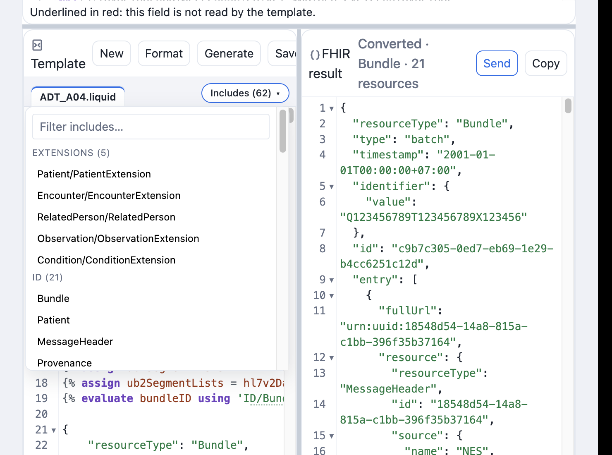
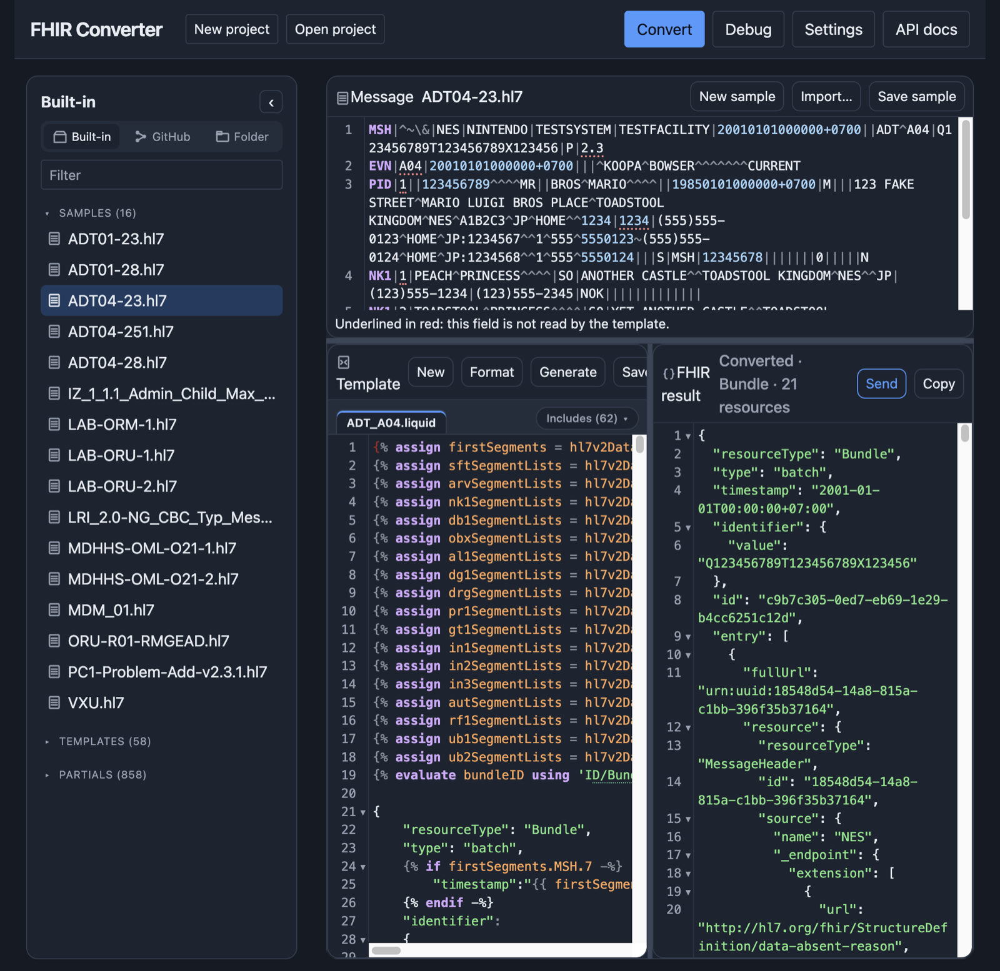

# Web UI Summary

Open `http://localhost:2019` for the browser editor. The annotated screenshots below match the current workspace.

| Area | What it does |
| --- | --- |
| Mode toggle (`HL7v2 → FHIR` / `FHIR → HL7v2`) | Switches the studio between inbound (`HL7v2` or `C-CDA` to FHIR R4 JSON) and outbound ([FHIR R4 Bundle to HL7 v2 ER7](features/fhir-to-hl7v2.md), such as Hospital Discharge `Composition` and `QuestionnaireResponse` samples with `MDM_T02`, `ADT_A03`, and `ORU_R01` templates) |
| Files | Samples, this customer's or direction's templates, and partials. Partials start collapsed. Menu opens customer, settings, and docs commands |
| Source input | A short strip (`Show full message` expands it) for HL7 v2 (including bare `\r` MLLP segments and `MSH-18` charsets), C-CDA XML, or a self-contained FHIR R4 `Bundle` JSON in `FHIR → HL7v2` mode. Paste one, or use New sample, Import, and Save sample |
| Template | Liquid editor with coloring and folding. The header icons are New template, Format, Fold/Unfold all sections, Generate, and Save template. Save turns clay when the template has unsaved edits. Includes lists the partials grouped by folder |
| Result & Send | In `HL7v2 → FHIR` mode, shows the live FHIR R4 Bundle with clean `FHIR Converter Liquid` Provenance narratives, Fold/Unfold toggle, click-to-trace field lineage, **Validate** (`{base}/$validate`), and **Send** to a FHIR server (with optional `urn:uuid:` conditional create or conditional update transactions). In `FHIR → HL7v2` mode, shows the rendered ER7 HL7 v2 message and **Send** posts to the configured **HL7v2 gateway** via `/api/v1/hl7v2/send` with `MSA` ACK verification |
| Debug | Bottom drawer: parsed HL7, parsed CDA, or indexed FHIR Bundle context (`byType`, `byRef`, `patient`, `encounter`), variable console, diagnostics (unused fields, unmapped local codes, undeclared segments, and case-mismatched Liquid variables), expected diff, and validation / gateway ACK status. Hover a path or field to see its value |
| New project / Open project | Start or load a local HL7 v2 or C-CDA project (with multi-facility HIE site packs), open a GitHub repo read-only, convert headless via `POST /api/v1/projects/:projectId/convert/:template` and `bin/convert.mjs`, or run per-customer `input/` and `output/` pipelines under `CUSTOMERS_ROOT` |
| Settings | Light, dark, or system theme, timezone, Convert API key (`Authorization: Bearer` sent automatically to protected server routes), **FHIR server** target, **HL7v2 gateway** target (URL, `json_envelope` or `raw_er7` format, Bearer/Basic auth, and `MSA` application ACK check), and AI template generation |
| API docs | Swagger UI, also at `/api-docs` |

## Usage

1. Choose **HL7v2 → FHIR** or **FHIR → HL7v2** in the studio header, then select or paste a sample message (HL7 v2 / C-CDA in inbound mode, or a FHIR R4 Discharge `Composition` / `QuestionnaireResponse` Bundle in outbound mode).
2. Open a template (`ADT_A01`, `ORU_R01`, etc. for `HL7v2 → FHIR`; `MDM_T02`, `ADT_A03`, `ORU_R01` for `FHIR → HL7v2`). The output pane updates while you edit when convert-while-typing is on.
3. Use Includes to jump into a partial, or type a missing name to start one.
4. Open Debug to inspect the parsed message or indexed FHIR Bundle, variables, and diagnostics.
5. Click **Send** to push a FHIR Bundle to the configured **FHIR server** (inbound mode) or push a rendered ER7 message to the configured **HL7v2 gateway** and verify `MSA|AA` (outbound mode).
6. Save writes the template to the built-in runtime tree (`src/service-templates/Hl7v2/` or `src/service-templates/FhirToHl7v2/`), or into the open local project. A GitHub project stays read-only.

Generate uses the provider and API key stored in Settings. Keys stay in the browser. Supported providers are OpenAI, Anthropic, Google Gemini, xAI (Grok), Mistral, DeepSeek, Groq, OpenRouter, a local OpenAI-compatible server, and a custom base URL.

C-CDA projects convert in the browser and through `bin/convert.mjs` (`npm run convert:project`). Choose C-CDA in **New project**, including the Microsoft baseline. The message is colored as XML, and the debug drawer shows **Parsed CDA**.

In cloud or production pipelines, set `HEADLESS_RUNTIME=true` (optionally with `CONVERT_API_KEY`, `PROJECTS_ROOT`, and `CUSTOMERS_ROOT`) to disable the browser studio, browse, write, and studio proxy routes (`403`) while keeping `/health`, `/version`, `/metrics`, and the authenticated convert and [customer pipeline](features/customer-pipelines.md) endpoints active. Details and screenshots are in [Features](features.md).
