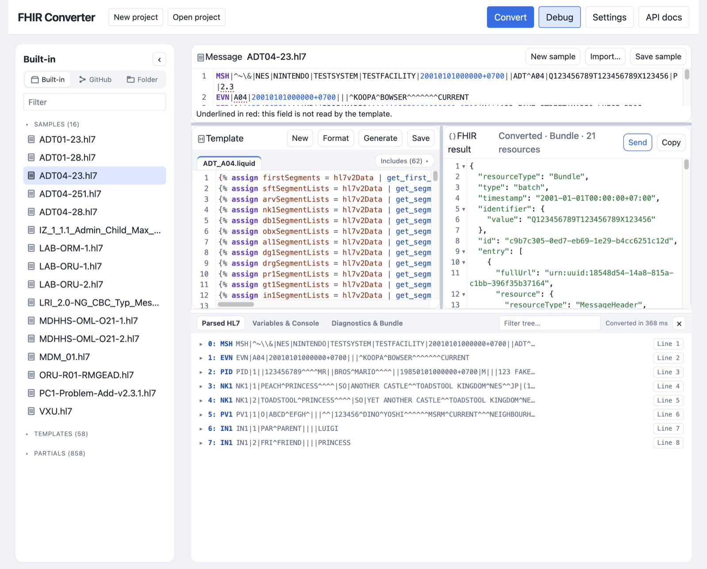
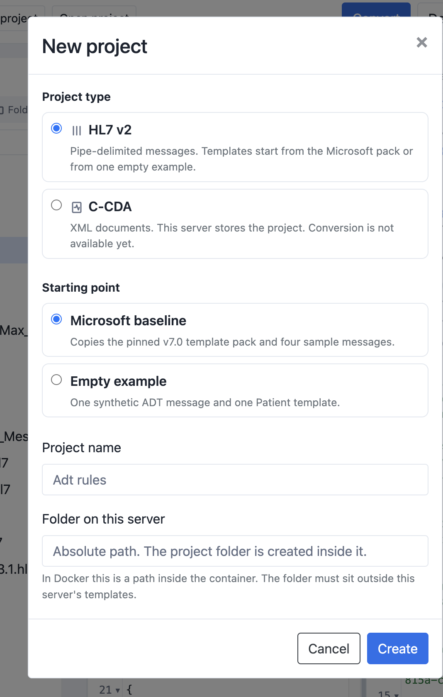
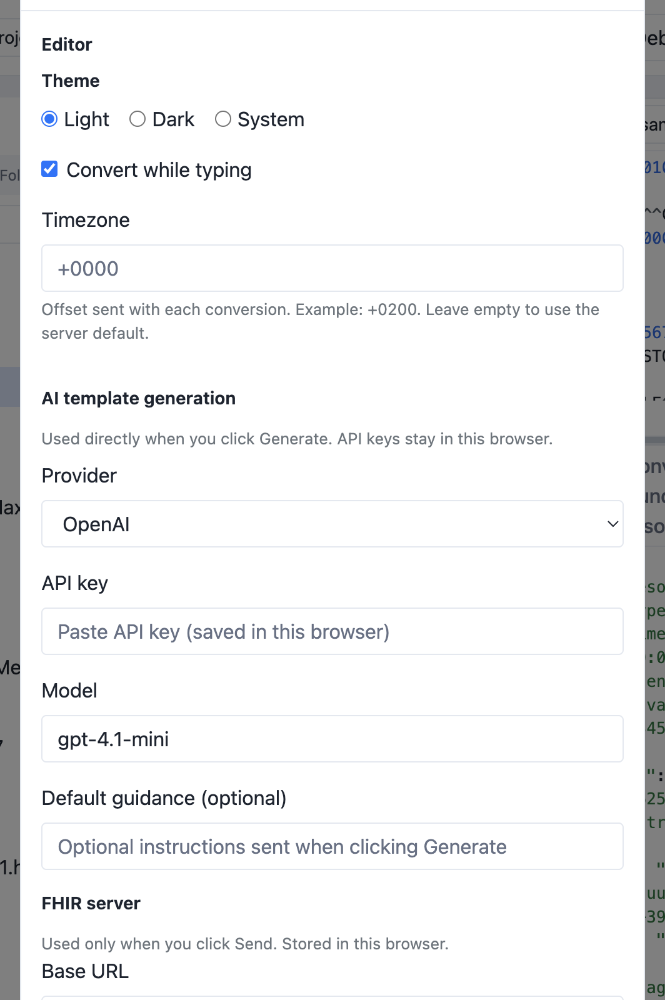

# Web UI Summary

Open `http://localhost:2019` for the browser editor. The annotated screenshots below match the current workspace.

| Area | What it does |
| --- | --- |
| Files | Samples, this customer's templates, and partials. Partials start collapsed. Menu opens customer, settings, and docs commands |
| Message | A short strip (`Show full message` expands it) for HL7 v2 (including bare `\r` MLLP segments and `MSH-18` charsets) or C-CDA XML. Paste one, or use New sample, Import, and Save sample |
| Template | Liquid editor with coloring and folding. The header icons are New template, Format, Fold/Unfold all sections, Generate, and Save template. Save turns clay when the template has unsaved edits. Includes lists the partials grouped by folder |
| FHIR result | Live bundle with clean `FHIR Converter Liquid` Provenance narratives (no `TEMPLATE_VERSION_PLACEHOLDER` or upstream tarball URLs) and a Fold/Unfold all sections toggle. Click a value for include and HL7 field lineage. Send posts to a FHIR server (with optional `urn:uuid:` conditional create or conditional update transactions). Validate posts to `{base}/$validate` |
| Debug | Bottom drawer: parsed HL7 or parsed CDA, variable console, diagnostics (unused fields, unmapped local codes, undeclared segments, and case-mismatched Liquid variables), expected diff, and validation. Hover a path or field to see its value |
| New project / Open project | Start or load a local HL7 v2 or C-CDA project (with multi-facility HIE site packs), open a GitHub repo read-only, or convert headless via `POST /api/v1/projects/:projectId/convert/:template` and `bin/convert.mjs` |
| Settings | Light, dark, or system theme, timezone, Convert API key (`Authorization: Bearer` sent automatically to protected server routes), FHIR server target, and AI template generation |
| API docs | Swagger UI, also at `/api-docs` |

## Usage

1. Select or paste an HL7 v2 message.
2. Open a template. The FHIR bundle updates while you edit when convert-while-typing is on.
3. Use Includes to jump into a partial, or type a missing name to start one.
4. Open Debug to inspect the parsed message, variables, and unused fields.
5. Save writes the template to the built-in runtime tree, or into the open local project. A GitHub project stays read-only.

Generate uses the provider and API key stored in Settings. Keys stay in the browser. Supported providers are OpenAI, Anthropic, Google Gemini, xAI (Grok), Mistral, DeepSeek, Groq, OpenRouter, a local OpenAI-compatible server, and a custom base URL.

C-CDA projects convert in the browser and through `bin/convert.mjs` (`npm run convert:project`). Choose C-CDA in **New project**, including the Microsoft baseline. The message is colored as XML, and the debug drawer shows **Parsed CDA**.

In cloud or production pipelines, set `HEADLESS_RUNTIME=true` (optionally with `CONVERT_API_KEY` and `PROJECTS_ROOT`) to disable the browser studio, browse, write, and outbound FHIR routes (`403`) while keeping `/health`, `/version`, `/metrics`, and the authenticated convert endpoints active. Details and screenshots are in [Features](features.md).
